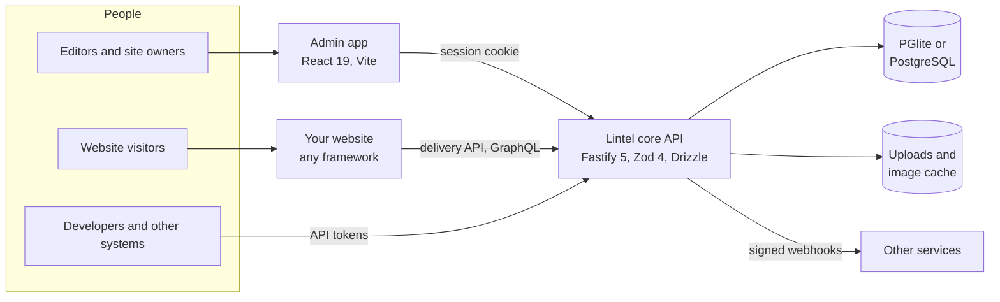
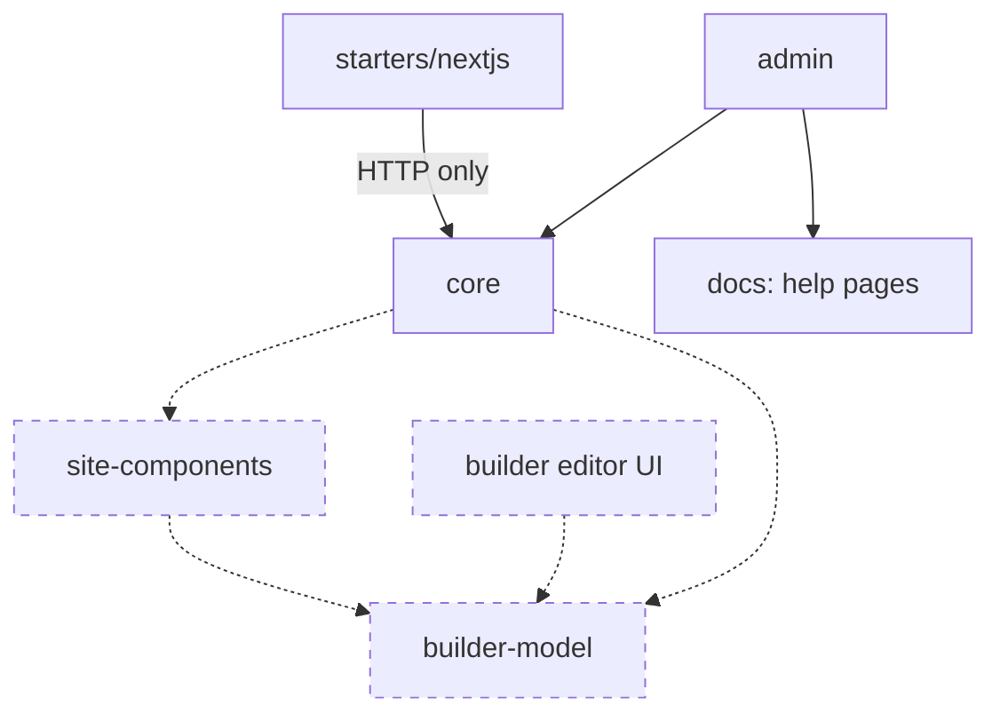
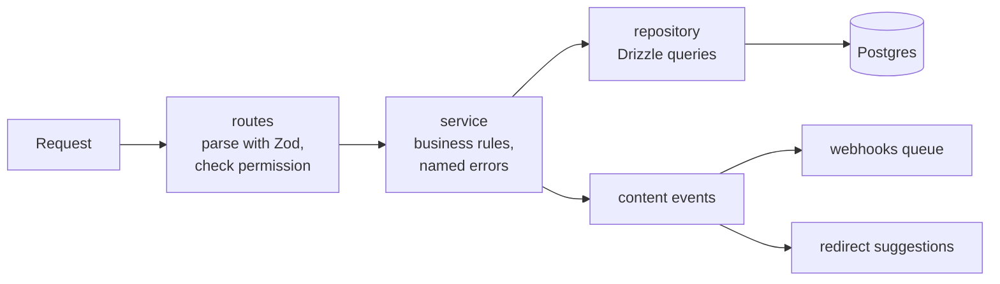
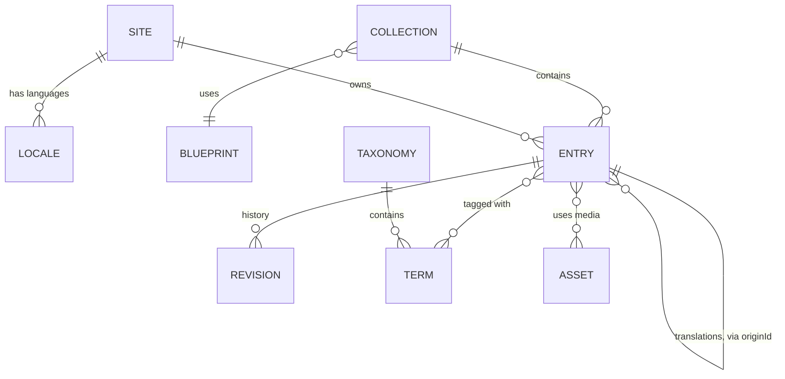
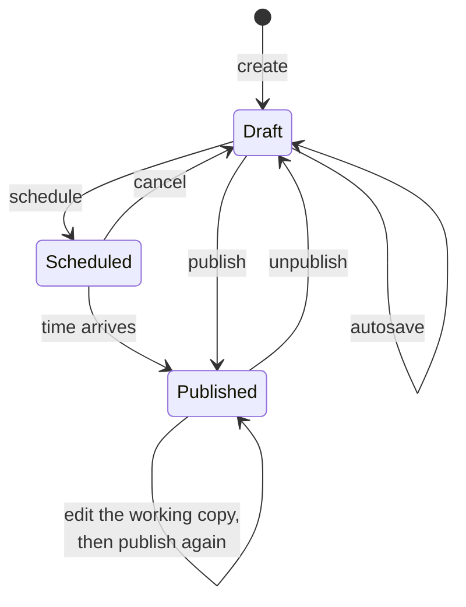
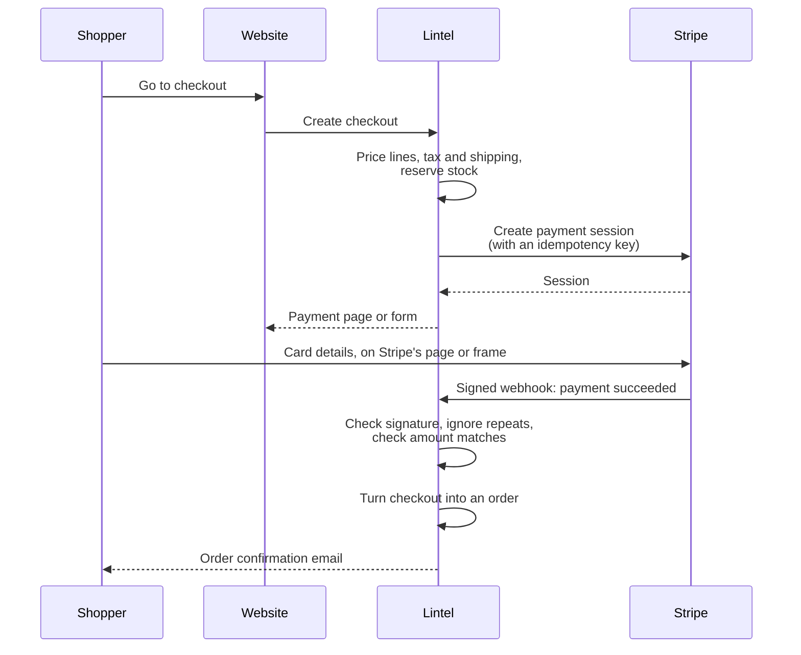
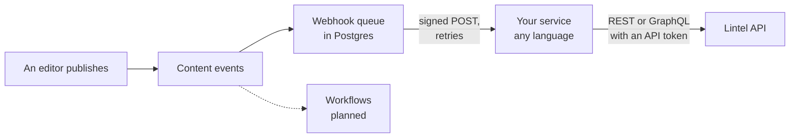

# Lintel: a technical whitepaper

For agency CTOs, technical leads and anyone choosing a platform to build client websites
and shops on. November 2026, describing the Lintel 1.0 release candidate and the work under way after it.

Lintel is a self-hosted content management system with a visual page builder, an
animation studio and built-in commerce, written in TypeScript. This paper explains what
it is for, how it is built, what it does today and what it does not do yet.

## How to read the status labels

Lintel is young, and much of what it aims to be is still being built. Every section says
which of these applies, and we have tried hard not to round up:

| Label              | Meaning                                                                                          |
| ------------------ | ------------------------------------------------------------------------------------------------ |
| **Available**      | In the Lintel 1.0 release candidate: merged, tested and documented. You can use it today.        |
| **In development** | Code exists on a development branch with tests, but it is not merged or released. It may change. |
| **Planned**        | Designed or scoped, with little or no code yet. Details will change.                             |

Where a section mixes them, each part is labelled.

## Contents

1. [Summary](#1-summary)
2. [The problem](#2-the-problem)
3. [Design principles](#3-design-principles)
4. [Architecture](#4-architecture)
5. [The content model](#5-the-content-model)
6. [Editing and publishing](#6-editing-and-publishing)
7. [The visual builder and its HTML](#7-the-visual-builder-and-its-html)
8. [Animation](#8-animation)
9. [Commerce and payments](#9-commerce-and-payments)
10. [Extensibility](#10-extensibility)
11. [APIs](#11-apis)
12. [Multiple sites and languages](#12-multiple-sites-and-languages)
13. [Security model](#13-security-model)
14. [Performance](#14-performance)
15. [Deployment and operations](#15-deployment-and-operations)
16. [White-label for agencies](#16-white-label-for-agencies)
17. [Licensing](#17-licensing)
18. [Roadmap](#18-roadmap)
19. [Further reading](#19-further-reading)

## 1. Summary

Agencies building sites for clients usually assemble a stack: a CMS for content, a page
builder or a front-end framework for layout, a separate platform for the shop, and glue
code to keep them in step. Each piece has its own admin, its own users, its own bill and
its own idea of what a product or a page is. The client, who is rarely technical, has to
learn all of them.

Lintel's aim is one system an agency can install on its own servers or its client's, that
a non-technical client can run day to day, and that a developer can read, extend and
trust. Concretely:

- **A structured CMS** in the tradition of Statamic and Umbraco: content types defined as
  fields, collections, page trees, taxonomies, global settings, menus, translations,
  drafts, scheduling and revision history. _Available._
- **APIs for any front end**: a public delivery API, a management API, GraphQL and an
  OpenAPI description, with webhooks for changes. _Available._
- **A visual builder** in the spirit of Webflow, whose pages are stored as structured data
  and rendered as readable HTML and CSS, on a website Lintel can serve itself. _Available._
- **Commerce** in the spirit of Shopify: products, variants, markets, inventory and
  checkout through Stripe, designed so the shop never handles card details. _In
  development._
- **An animation studio** for scroll and interaction effects. _Planned._
- **Extensibility** through plugins, external apps in any language, and workflows.
  _Partly available_: webhooks, API tokens, plugins that add routes, tables, fieldtypes and
  admin screens, and automations are available; external apps are _planned_.

It is source-available, with a free core and a paid Pro edition planned
([section 17](#17-licensing)).

## 2. The problem

We built Lintel because of problems we kept meeting on agency projects. They are worth
stating plainly, because they explain most of the design.

**Clients can't use the tools.** Most CMS admins are designed by developers for
developers. Editors are shown every feature at once, error messages talk about schema
validation, and the safest way to change a live page is to ask the agency. Each request
like that is either unbilled time or a frustrated client.

**The stack sprawls.** A typical brochure-plus-shop site might use a headless CMS, a
hosted commerce platform, a form service, a search service and a static host. Content
about a product lives in two places. Every service needs its own accounts, backups and
security review, and the monthly cost grows with each one.

**Visual builders lock you in.** Hosted builders produce good-looking sites quickly, but
the output is hard to move, the HTML is often a deep nest of generated class names, and
the content is tied to layout so it can't easily be reused in an app or another channel.

**Hosted means someone else's rules.** Pricing changes, data residency requirements, rate
limits and outages are outside the agency's control. Some clients (public sector,
healthcare, finance) need their data on infrastructure they choose.

**Self-hosted often means fragile.** The traditional self-hosted alternatives are mature,
but extending them can mean learning a large framework's conventions, and upgrades can be
risky when plugins reach into internals.

Lintel tries to keep the strengths of each approach (structured content, visual layout,
integrated commerce, self-hosting) without the parts that make them hard to live with.

## 3. Design principles

Four principles decide most trade-offs. When they conflict, they are applied in this
order.

### Non-technical people first

The person using the admin every day is usually not a developer, so:

- **Plain English everywhere.** Errors say what happened and what to do: "Heading is
  required" or "Lintel can't reach Postgres at localhost:5432. Is it running?", never a
  stack trace or a schema path. The API's errors are named, each with a message an
  editor could understand.
- **Only what you need.** Setup asks "What are you building?" (business site, blog, shop,
  portfolio or blank) and switches on only the features that kind of site needs. People
  only see the buttons they are allowed to use: an editor who can't publish sees **Save**,
  not **Publish**.
- **Safe by default.** Drafts are separate from the live site; saving never publishes.
  Switching a feature off hides it but deletes nothing. Deleting a picture that pages
  still use is refused, with a list of those pages.
- **Accessible.** Every input has a visible label, everything works by keyboard, focus is
  always visible, motion respects the reduced-motion setting, and the admin has light and
  dark modes.

The admin is a React application with its own design system: calm, spacious and
consistent, closer to a well-made phone app than to a traditional control panel.

### Clean code a newcomer can read

Agencies need to be able to audit, debug and extend what they deploy. The codebase follows
a short set of rules (in `CONTRIBUTING.md`) that are enforced in review:

- **Folders by feature.** Everything about orders lives in `orders/`: table, schema,
  routes, service, repository, tests and a README.
- **Three layers, always in order.** Routes handle HTTP and permissions only, services
  hold business rules, repositories hold queries. You always know where a rule lives.
- **No magic.** Routes, fieldtypes and plugins are registered in lists you can read, not
  discovered from file names.
- **One schema per entity.** A single Zod schema validates input and types the code, so a
  shape is never written twice.
- **Strict TypeScript**, no `any`, and decision records for every choice that would be
  expensive to reverse.

### Extensible without forking

An agency should be able to add a field type, a payment step or a connection to a
client's ERP without editing core files, and upgrade afterwards. Today that is done
through APIs, webhooks and the plugin switchboard; a fuller plugin system is planned
([section 10](#10-extensibility)).

### Self-hosted, and simple to host

Lintel runs anywhere Node.js 22 runs. It ships with a built-in database (PGlite, which is
Postgres compiled to WebAssembly), so trying it needs nothing installed beyond Node and
pnpm. Production sites use a standard PostgreSQL server, one setting away. The same
schema, migrations and queries run on both.

## 4. Architecture

### The pieces

Lintel is a pnpm and Turborepo monorepo, TypeScript from database to browser.

| Package                    | What it is                                                             | Status         |
| -------------------------- | ---------------------------------------------------------------------- | -------------- |
| `packages/core`            | The API server: content, media, users, permissions, delivery, webhooks | Available      |
| `packages/admin`           | The admin app: React 19, TanStack Router and Query, Tailwind 4         | Available      |
| `packages/docs`            | The documentation site (Astro Starlight), also bundled as in-app help  | Available      |
| `starters/nextjs`          | A Next.js website that reads the delivery API                          | Available      |
| `packages/builder-model`   | The visual builder's page model, styles and HTML import, with no UI    | In development |
| `packages/site-components` | The React components a Lintel-rendered website is made of              | In development |
| Commerce in `core`         | Products, markets, inventory, checkouts and Stripe                     | In development |

### How the packages depend on each other

Dashed boxes are in development or planned. The builder's model is plain TypeScript with
Zod as its only dependency, so the server (to validate pages), the editor (to change them)
and the website (to draw them) share one definition.

### Inside the API

Every feature folder in `packages/core/src` has the same shape, and a request always
passes through the same layers:

A few choices shape everything else; each has a decision record in `docs/decisions`:

- **Postgres everywhere** (0002, 0005). Money and stock need transactions and
  constraints; flexible content fields live in `jsonb` columns. PGlite means the
  development database, the test database and a small production site can all be real
  Postgres with nothing to install.
- **A tenant column on every table** (0003). Every row carries `tenant_id`, and unique
  indexes include it, so a managed, multi-customer service can later isolate customers
  with Postgres row-level security without migrating every install.
- **Server-side sessions, not JWTs** (0004). Signing out, removing a user and changing a
  role take effect on the next request.
- **Migrations on start.** The server applies pending migrations when it starts;
  `pnpm db:migrate` does the same as a separate deploy step.

## 5. The content model

_Available._

Lintel's content model follows Statamic's vocabulary, which we found easiest to explain
to clients.

- **Fieldtypes** are the kinds of field: text, long text, rich text, Markdown, number,
  toggle, select, date, image, link, email, web address, colour, list, links to entries,
  taxonomy terms and blocks. Seventeen in all. Each defines its options and a Zod schema
  for its stored value, so one function checks any entry against any blueprint.
- **Blueprints** are lists of fields. **Collections** group entries that share a
  blueprint, with a structure (a page tree, dated like a blog, or a flat list) and an
  address pattern such as `/blog/{slug}`. The admin calls the pair a "content type", and
  editors build them with a drag-and-drop field builder.
- **Taxonomies** (categories, tags), **global sets** (site-wide values such as a phone
  number or footer text) and **menus** complete the model.
- **Blocks fields** hold an ordered list of typed blocks (Hero, Text, Call to action...),
  each with its own fields, validated with the same rules as top-level fields. This is how
  page layouts are composed today, before the visual builder arrives.

Values are validated on the server, not just in the admin. Link fields refuse
`javascript:` addresses, empty values are stored as null, and required fields are
enforced when publishing rather than on every save, so an editor can save a half-written
draft without being blocked.

**Content model as code** is _planned_: defining blueprints and collections in versioned
files in the project repository (as Statamic and Umbraco allow), so a model can be
reviewed in a pull request and deployed between environments. Today blueprints live in
the database and are edited in the admin.

## 6. Editing and publishing

_Available_, unless marked otherwise.

### Drafts and the live site

Each entry has two copies of its values: the working copy editors change, and a copy
taken when it was last published. The delivery API reads only the published copy, so
drafts, unpublished changes and scheduled entries that haven't gone live can't leak
through it (decision 0006). Lintel can tell whether there is anything new to publish by
comparing the two.

### Editing

- The editor **autosaves** a moment after typing stops. Revisions gather one person's run
  of edits into a single history entry, closed by publishing, by someone else editing, by
  30 minutes passing or by pressing **Save version** (decision 0011). History stays
  readable instead of filling with identical "Saved" lines, and any revision can be
  restored.
- **Live preview** shows the draft on the real website beside the editor, using a signed
  token that opens one entry for half an hour (decision 0008).
- **Scheduling** publishes at a set time. The scheduler claims each due entry in a single
  database update, so several servers can run side by side without publishing twice.
- **Search** across entries and media from a command palette (Cmd/Ctrl+K), using Postgres
  full-text search.
- **Media**: uploads with alt text and a focal point that every crop keeps in view,
  duplicate detection, and resized, re-encoded images on demand.
- **SEO tools** (a plugin): per-page titles and descriptions with length guidance, social
  images, a sitemap, robots.txt and redirects. When a live page's address changes, Lintel
  suggests a redirect and keeps existing redirects free of chains and loops.

### Roles and approvals

Permissions are checked on every route, and the admin hides what a person can't use.
There are five built-in roles (Owner, Admin, Editor, Author and Viewer), with "own content"
permissions so an Author can publish their own posts but not other people's, and custom
roles built from permissions described in plain words.

- **A Users screen** with invitations by email, deactivation, password reset by email,
  two-factor sign-in, passkeys and a security log. _Available._
- **Content approval** (for example, "an editor must approve before publishing"), as part
  of automations ([section 10](#10-extensibility)). _Available._

## 7. The visual builder and its HTML

_Available._ Lintel works headless (your website reads content from the API and renders it
with whatever framework you choose) or serves the website itself, from templates and themes.
Pages can be laid out in the visual builder, and the built-in website draws them with the
same renderer as the builder's canvas (decision 0015).

### What it is

A Webflow-style editor: a canvas showing the real page, a layers panel, a style panel
with breakpoints and states, ready-made sections, and a code view. It is meant for
designers and confident editors; clients who only change text and pictures keep using
fields and blocks.

### How a page is stored

A page is a JSON tree of nodes, versioned so the shape can evolve:

- Each node has a component type (section, heading, image, button...), `props` (what it
  shows) and `styles` (how it looks).
- **Props are validated** by each component's Zod schema on the server before saving, so
  a page that the editor can't draw can't be stored.
- **Styles are an allow-list**, not free CSS. Only listed properties are accepted, and
  values can't break out of their declaration. Styles cascade from `base` (desktop) to
  `tablet` and `phone`, with `hover` and `focus` states.
- **Design tokens** (brand colour, fonts, spacing) are CSS custom properties, so a theme
  change reaches every page.
- **Tree changes are immutable**: each change returns a new tree that shares every
  untouched node, which makes undo simple and redrawing cheap.
- **Document migrations** run when a page is read, so an upgrade never needs a database
  script for page content.

### The HTML it produces

We care about the output because agencies inherit it, search engines read it and
accessibility depends on it.

- **Readable class names.** Every element gets one class, named after its layer: a node
  called "Hero" becomes `.hero`, an unnamed heading `.heading`, with numbers for repeats
  (`.heading-2`). Renaming a layer is how you give an element a stable class.
- **One compiled stylesheet** per page from the style cascade, with media queries for the
  breakpoints, instead of inline styles.
- **Static HTML.** Lintel's site components render with React on the server to plain
  markup: no hydration markers, no framework runtime, attribute names in conventional
  lower case, and the same input always giving the same HTML.
- **Accessible structure** from the components themselves: skip links, real headings,
  menus that work by keyboard, responsive images with `srcset` and alt text.
- **HTML import.** Pasting HTML into the builder turns known tags (headings, paragraphs,
  links, images, lists, sections) into editable elements. Anything else becomes a code
  block for people allowed to add code, or is left out and reported. Scripts and styles
  are always left out.
- **Code blocks** for developers, with a site-wide rule: by default anything that runs
  JavaScript (scripts, event handler attributes, `javascript:` links) is removed when the
  page is saved; a site can allow scripts explicitly. Either way the editor draws code
  blocks inside a sandboxed frame so code can't reach the admin.

What exists today on the development branch is the model (schema, validation, components,
style compiler, class names, tokens, tree operations, HTML import and section templates)
and the site components with two templates and a theme system. The editor interface
itself is not built yet.

## 8. Animation

_Planned._ No animation code exists yet. This section states the intent so that buyers
can judge whether the direction suits them; details will change.

The animation studio is meant to let a designer add entrance, scroll and hover effects to
builder elements on a timeline, without writing code. Our constraints for it:

- **Motion explains, it doesn't decorate.** This is already a rule for the admin, and the
  same thinking applies to sites: effects should show cause and effect or guide the eye.
- **Reduced motion is always honoured.** Visitors who ask their device for less motion
  get the final state without the movement. This will not be an option a site can turn
  off.
- **Small, standard output.** Animations are stored as data on the page, like styles, and
  rendered with CSS and the browser's standard animation features wherever possible, with
  only a small script where scroll position is involved.
- **No layout jank.** Effects should animate transform and opacity rather than layout
  properties, so they don't slow pages down.

## 9. Commerce and payments

_In development._ The shop's foundations are on a development branch: tables, money
handling, markets, inventory, products and the Stripe connection. Carts, checkout,
orders and the admin screens are being built on top. Nothing here is released yet.

### The model

- **Money is integers.** Every amount is a whole number in the currency's smallest unit
  (`1999` EUR is €19.99, `1999` JPY is ¥1,999), so totals never pick up floating-point
  pennies, and adding two currencies without converting is an error.
- **Products and variants**, with SKUs, weights, images and rule-based product
  collections ("everything tagged summer under €50").
- **Markets** group countries with a currency and prices, so one shop can sell in the UK
  in pounds and in the EU in euros.
- **Inventory** per location, with stock **reserved** while a shopper pays and released
  automatically when a checkout is abandoned.
- **Emails** go to an outbox readable in the admin, behind a small provider interface, so
  any mail service can be plugged in. Discounts have a similar interface.

### Payments and the SAQ A approach

Card payments are the riskiest thing a website can do, and PCI DSS compliance is the
merchant's obligation. Our approach is that **card details never touch Lintel or the
merchant's servers**. Payment details are entered only on pages or frames served by
Stripe:

- **Stripe Checkout**: the shopper is redirected to a Stripe-hosted payment page.
- **Stripe Payment Element**: Stripe's payment form is embedded in the site as an iframe
  served by Stripe.

Both are the kinds of integration that PCI DSS's shortest self-assessment questionnaire,
**SAQ A**, is meant for: e-commerce merchants that fully outsource card data handling to a
PCI DSS compliant provider. Lintel never receives, stores or forwards a card number.

Some details that matter:

- **An order exists only when Stripe says so.** A checkout becomes an order only after a
  signed webhook confirms the payment, never because the browser came back to a
  "thank you" page.
- **Webhooks are verified**: HMAC signatures are checked in constant time, signatures more
  than five minutes old are refused, and each Stripe event is recorded so a repeated
  delivery has no effect.
- **Mismatches stop for a person.** If Stripe reports a payment that doesn't match the
  checkout total, the checkout is marked "needs review" and never becomes an order
  automatically.
- **Requests to Stripe are idempotent**, so a retry after a network failure can't create a
  second payment.

To be clear about the limits: using Stripe's hosted page or frame keeps a shop _eligible_
for SAQ A, but it doesn't make anyone compliant on its own. Which questionnaire applies is
agreed between the merchant and their payment provider, and SAQ A still asks the merchant
to protect the pages that send shoppers to payment from tampering. A site that adds its
own scripts, or that allows scripts in builder code blocks, takes on that responsibility.
Stripe is the only payment provider being built; others would come through the same
interfaces later.

## 10. Extensibility

Lintel offers several ways to extend it, at different levels of commitment. The table
shows where each stands.

| Mechanism                    | What it is for                                               | Status    |
| ---------------------------- | ------------------------------------------------------------ | --------- |
| Delivery and management APIs | Any program, in any language, reading and changing content   | Available |
| Webhooks                     | Telling other services when something happens                | Available |
| API tokens                   | Giving a script or app scoped access                         | Available |
| Plugin switchboard           | Switching first-party features on and off                    | Available |
| Plugins with code            | Adding routes, tables, fieldtypes and admin screens          | Available |
| External apps                | Separately hosted apps with their own admin screens          | Planned   |
| Workflows                    | "When this happens, do that" automation, including approvals | Available |
| Hooks in any language        | Letting external code take part in an operation              | Planned   |

### Available today

**Webhooks.** Admins add an address and choose events: an entry published, unpublished or
deleted, a file uploaded or deleted. Each delivery is a JSON `POST` signed with
HMAC-SHA256, with a delivery id that stays the same across retries. Failed deliveries are
retried after 1 minute, 5 minutes, 30 minutes, 2 hours and 12 hours, from a queue in the
database, so retries survive restarts and several servers can share the work. A log keeps
every attempt, with a **Resend** button. Webhooks can't be pointed at private or internal
network addresses (see [section 13](#13-security-model)).

**Any language, today.** Because webhooks are signed HTTP and the APIs are REST and
GraphQL with an OpenAPI description, a Python, PHP, Go or C# service can already react to
content changes and write content back, with a generated client if wanted.

**The event bus.** Inside the server, features react to each other through an event bus
with a single, visible list of listeners (webhooks, redirect suggestions, the built-in
website's cache, automations) rather than reaching into each other's code. A listener that
fails is logged and doesn't undo the editor's change.

**Plugins.** Optional features (blog, shop, forms, automations, SEO) are plugins that setup
switches on, and Settings → Features switches on or off later. Switching one off hides it
without deleting content. A plugin, built in or installed from a package listed in
`lintel.config.ts`, is a `definePlugin` that can add routes, tables with their own
migrations, settings, permissions and fieldtypes, with an admin half that adds screens,
settings rows, dashboard widgets and editor panels (decision 0012). The Bookings example
shows a complete one.

**Automations.** Site owners chain triggers (content events, schedules, or a button) to
actions (send an email, call a web address, ask for approval, publish) from the admin,
without code. Runs are stored, so waits and retries survive restarts.

### Planned

**External apps** will be separately hosted services (in any language) that a site
installs with scoped API access and that can add screens or panels to the admin. This
keeps third-party code out of the Lintel process.

**Hooks in any language** will let an external service take part in an operation rather
than only hear about it afterwards, such as checking an order before it is accepted, by
calling a signed HTTP endpoint with a timeout and a defined fallback.

## 11. APIs

_Available._

| API             | Path                                     | Who uses it                                         |
| --------------- | ---------------------------------------- | --------------------------------------------------- |
| Delivery (REST) | `/delivery/...`                          | Websites and apps reading published content         |
| GraphQL         | `/graphql`                               | The same content, typed from the content model      |
| Management      | `/entries`, `/media`, ...                | The admin, scripts and integrations                 |
| OpenAPI 3.1     | `/openapi.json`                          | Postman, code generators, the admin's API reference |
| SEO             | `/sitemap.xml`, `/robots.txt`, redirects | Websites serving them from their own address        |

**Delivery** is public by default because it only serves published content; a site can
require a token instead. Responses expand references once per response: image fields come
back with URLs, dimensions, alt text and focal point; rich text as both JSON and HTML;
links to other entries as their published addresses in the requested language. Lists
paginate and filter by taxonomy term.

**GraphQL** is generated from the blueprints and rebuilt when the content model changes,
so each collection has typed queries with the same field names as REST. Query depth and
cost are limited before execution (decision 0009).

**The OpenAPI document** is built from the same Zod schemas the routes validate with, and
a test fails if a public route is missing from it, so the description can't drift from
the code.

**API tokens** come in two kinds: `read` (published content only, safe to put in a
website's code) and `readWrite` (drafts and changes). Neither reaches users, roles or
settings, and a token can never do more than the admin who made it.

**Cross-origin access** is off by default; allowed origins are listed in settings and get
CORS headers on the delivery, GraphQL and OpenAPI paths only, without cookies.

A Next.js starter shows a complete site built on the delivery API: pages, a paginated
blog, menus, focal-point image crops and page metadata.

## 12. Multiple sites and languages

### Languages

_Available._ A site can have several languages. A translation is an ordinary entry in
another language linked to the entry it was translated from (decision 0007), so
everything that works for entries (validation, drafts, scheduling, history, preview)
works for translations with no special cases. The French page can be published a week
after the English one, with its own address (`/a-propos`) or the same one. The delivery
API takes a `locale`, lists where each entry is published in other languages (for
language switchers and `hreflang`), and follows links to the right translation. Global
settings are kept per language, falling back to the main language.

Not yet translated: taxonomy terms and menu labels. The admin's own interface is in
English only today; every string goes through one translation function, so other
languages can be added without touching screens.

### Multiple sites

_Planned._ Every install has one site today. The data model was built for more: entries
belong to a site, and every table carries a tenant column. Managing several sites (each
with its own domains, languages and content, sharing users and media where wanted) from
one install is the next step after the current development work.

## 13. Security model

_Available_, unless marked otherwise. Lintel has not had an independent security audit
yet; we intend to commission one before a 1.0 release.

### People and permissions

- **Passwords** of at least 12 characters, hashed with scrypt, with cost settings stored
  per hash so they can be raised.
- **Sessions** are random 256-bit tokens in an `HttpOnly`, `SameSite=Lax` cookie; only a
  SHA-256 hash is stored, so a leaked database can't be used to sign in. Signing out or
  removing a person ends their sessions at once. Resetting a password signs out
  everywhere.
- **Sign-in** is rate limited per address.
- **Permissions** (such as `entries:publish`) are checked on every route through one
  function, read fresh from the person's roles on each request.
- **First-run setup** is protected: until the first account exists, setup requests from
  any other computer need a one-time code printed in the server's terminal, and requests
  through a proxy count as remote.
- Two-factor sign-in, single sign-on and a security log: _planned_.

### Content and media

- **Drafts can't leak.** Public delivery reads only the published copy, and an
  unpublished entry gets the same 404 as one that doesn't exist.
- **Preview links** are HMAC-signed, name one entry and expire after 30 minutes.
- **Uploads are checked by their bytes**, not their name: a program renamed `photo.png` is
  refused. SVGs with scripts, event handlers or embedded HTML are refused rather than
  cleaned. Files are served with `nosniff` and a sandboxing Content-Security-Policy.
- **Link fields** refuse `javascript:` addresses; typed HTML in Markdown is escaped.

### APIs and integrations

- **API tokens** are shown once and stored hashed, limited to their kind and to their
  maker's permissions, and an unknown token is an error rather than a quiet fall back to
  public access.
- **Webhooks** can't reach loopback, private, link-local (including cloud metadata
  addresses) or reserved networks, in IPv4 or IPv6, and addresses are checked again when
  connecting so DNS can't be switched afterwards. Redirects are not followed.
- **GraphQL** depth and cost limits stop expensive queries before they run.
- **Search input** is reduced to letters and numbers before it reaches the database.

### Tenancy

Every table carries a tenant column, so a future managed service can separate customers
with Postgres row-level security. Self-hosted installs use a single tenant.

## 14. Performance

We have not published benchmarks, and won't quote numbers until we have measured them on
realistic sites. What we can describe is how the design avoids the usual costs.

- **Cacheable delivery.** Delivery responses are `public, max-age=60`, so a CDN or the
  website's own cache absorbs most traffic, and a publish shows within a minute.
- **Images.** Resized images are made once and kept on disk; every image URL carries a
  fingerprint, so it can be cached for a year as immutable, with `ETag` and `304`
  responses for the rest. Modern formats (WebP, AVIF) are available on request.
- **No N+1 queries in delivery.** Images, terms and linked entries are looked up once per
  response, not once per field.
- **GraphQL schema** is built once and kept until the content model changes.
- **Search** scans entries with Postgres full-text search, which is fast at the size of a
  typical site; an index on the same expression is the next step when sites grow.
- **Static site output.** Pages rendered by Lintel's site components (_in development_)
  are plain HTML and one stylesheet with no framework runtime in the browser.
- **Horizontal scale.** Scheduled publishing and webhook delivery claim work with a
  single database update, so several API servers can run behind a load balancer.

The built-in database serves one process from one folder. It suits development, trials
and small single-server sites; busier sites should use a PostgreSQL server.

## 15. Deployment and operations

### Today

_Available._ Lintel needs Node.js 22 or newer and pnpm. `pnpm install` and `pnpm dev`
start it with the built-in database, and the browser-based setup screen chooses the
database, creates the first account and picks the site type. For production:

- Set `DATABASE_URL` to a PostgreSQL server (or choose one on the setup screen, which can
  test the connection and create the database).
- Build with `pnpm build`; migrations run on start, or separately with `pnpm db:migrate`.
- Put the API and admin behind a reverse proxy with HTTPS. `GET /health` serves uptime
  checks.
- Uploads are stored on local disk through a small storage interface (`put`, `get`,
  `delete`, `exists`). An S3-compatible driver (for S3 or Cloudflare R2) is documented but
  not built.
- Back up Postgres with its standard tools, plus the uploads folder.
- Recovery commands: `pnpm create-admin` and `pnpm reset-password`.

### Planned

_Planned._ Official Docker images and a production Compose file,
deployment guides for common hosts, an S3-compatible storage driver, and import and export
of content between installs. A managed hosting option is under consideration for later;
self-hosting will remain a first-class choice.

## 16. White-label for agencies

Agencies often want the admin to feel like part of their own service.

- **Available:** the admin is styled entirely through design tokens (colours, surfaces,
  text) rather than fixed colours, so its look can be changed in one place, and the
  in-app help is bundled from the docs, so it works offline.
- **Planned:** white-label settings in the admin: the agency's name and logo on the
  sign-in screen and sidebar, an accent colour, custom help links and support contact, and
  the option to hide Lintel branding, per install. White-label is expected to be part of
  the Pro edition.

## 17. Licensing

_Planned._ The licence file has not been added to the repository yet. Until it is, the
terms below are our plan, not a grant of rights.

- **The core** is planned to be source-available under the **Functional Source License**
  (FSL). FSL lets anyone read, run, modify and redistribute the code for any purpose
  except offering a product or service that competes with Lintel. Each release converts
  to a standard open-source licence (Apache 2.0 or MIT) two years after it is published.
  As we read it, agencies building and hosting client sites on Lintel is permitted use;
  the licence text will be the authority.
- **Lintel Pro** is planned as a paid edition with features that matter most to agencies
  and larger sites (white-label is expected to be one). The split between core and Pro is
  not final.

We chose a source-available licence so that agencies can audit and patch the code they
deploy, clients aren't locked in, and the project can still fund full-time development.

## 18. Roadmap

We don't publish dates. This is the order of work.

| Stage                 | Scope                                                                                                                                         | Status           |
| --------------------- | --------------------------------------------------------------------------------------------------------------------------------------------- | ---------------- |
| Foundations           | Monorepo, design system, sign-in, sessions, permissions, browser setup, built-in database                                                     | Available        |
| Content               | Content types, 17 fieldtypes, collections, entries, media, drafts, publishing, history                                                        | Available        |
| Editor and APIs       | Blocks, live preview, search, scheduling, taxonomies, globals, menus, languages, REST, GraphQL, OpenAPI, webhooks, SEO, docs, Next.js starter | Available        |
| Visual builder        | Page model, HTML import and the builder screen                                                                                                | Available        |
| Site rendering        | Lintel-rendered websites: components, templates, themes                                                                                       | Available        |
| Commerce              | Products, markets, inventory and Stripe; checkout, orders and screens next                                                                    | In development   |
| Accounts              | Users screen, roles, invitations, email password reset                                                                                        | Available        |
| Forms                 | Contact forms and submissions                                                                                                                 | Planned, started |
| Plugins               | Plugins that add routes, tables, fieldtypes and screens                                                                                       | Available        |
| Workflows             | Triggers, actions and approvals                                                                                                               | Available        |
| Content model as code | Blueprints and collections in versioned files                                                                                                 | Available        |
| Animation studio      | Timeline effects for builder pages                                                                                                            | Planned          |
| Security hardening    | Two-factor sign-in and security log available; independent audit planned                                                                      | Partly available |
| Deployment            | Docker images, hosting guides, S3-compatible storage                                                                                          | Planned          |
| White-label           | Agency branding of the admin                                                                                                                  | Planned          |
| Multiple sites        | Several sites and domains from one install                                                                                                    | Planned          |

## 19. Further reading

- [Getting started](https://github.com/DanielHuntr/lintelcms#getting-started): install
  and run Lintel.
- [How code is written in Lintel](https://github.com/DanielHuntr/lintelcms/blob/main/CONTRIBUTING.md):
  the rules every feature follows.
- [Decision records](https://github.com/DanielHuntr/lintelcms/tree/main/docs/decisions):
  why the big choices were made, and what we turned down.
- [Lintel at a glance](https://github.com/DanielHuntr/lintelcms/blob/main/docs/overview.md):
  a one-page summary for non-technical readers.
