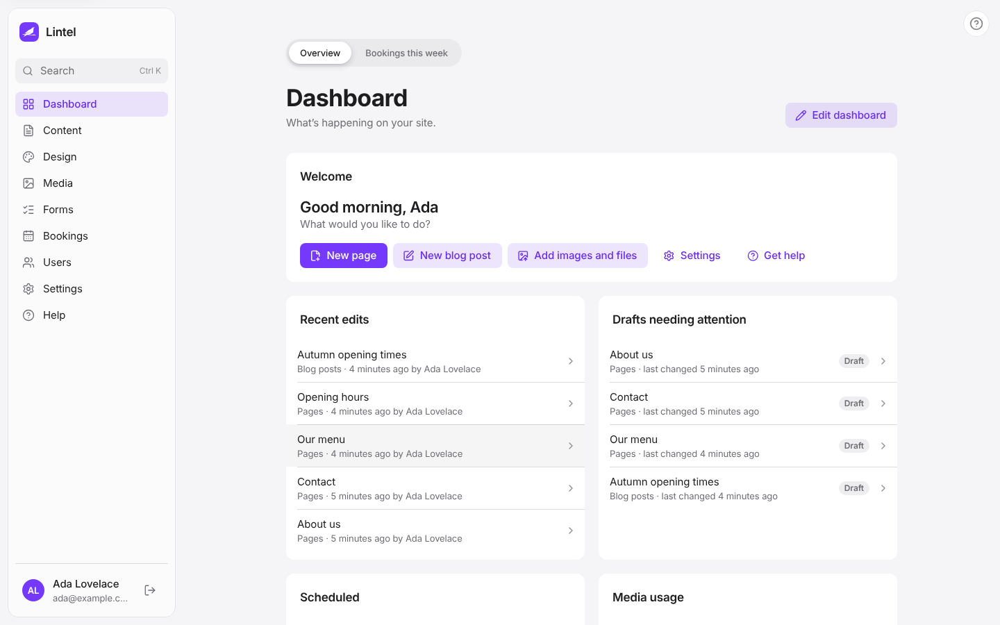
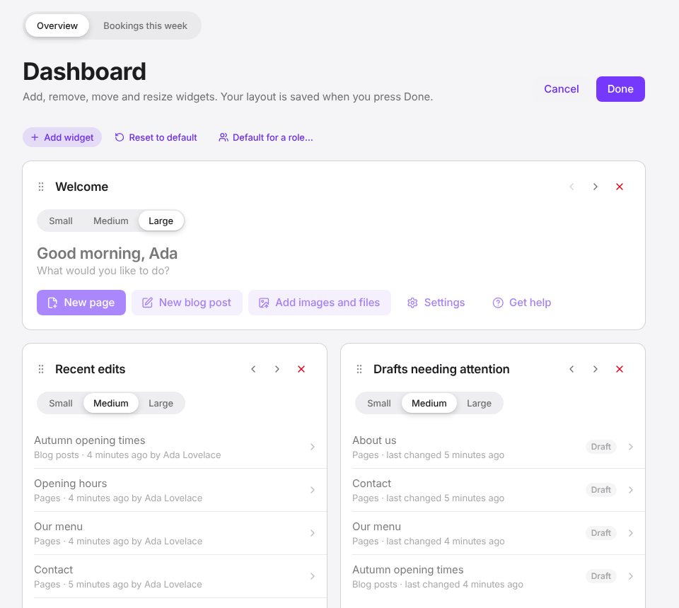

The home screen is a dashboard of widgets that each person arranges for themselves.
Plugins can add widgets to it, and tabs beside it and beside the Content overview.



## How a dashboard is chosen

1. The person's own layout, once they have pressed **Done** in Edit mode.
2. Otherwise their role's default, set by an admin. With several roles that have one, the
   first by role name.
3. Otherwise Lintel's default: every widget marked `onDefaultDashboard`, in order, at its
   `defaultSize`.

**Reset to default** removes the person's own layout, so the next one in this list shows.
Layouts are stored by the API (`dashboard_layouts`), so they follow people between
computers.

## Edit mode

**Edit dashboard** shows, on every widget, a drag handle, **Move earlier** and **Move
later** buttons (the keyboard way to reorder), a Small / Medium / Large control and a
remove button. **Add widget** opens a gallery of the widgets not yet placed, with a line
about each. **Done** saves; **Cancel** throws the changes away. Each change is announced
to screen readers ("Media usage moved to position 2 of 5.").

People who can change settings also see **Default for a role…**, which makes the layout
on screen the one a role starts from, and lists the roles that have one with a button to
remove it. People keep any layout they arranged themselves.



## Sizes

The dashboard is a six-column grid. **Small** is two columns (a third), **Medium** three
(a half), **Large** all six. In a narrow window every widget takes the full width.

## Lintel's widgets

| Id                     | Shows                                                          | Needs          |
| ---------------------- | -------------------------------------------------------------- | -------------- |
| `core:welcome`         | A greeting and quick actions: new page, new post, upload, help | nothing        |
| `core:recent-edits`    | The entries changed most recently, and by whom                 | `entries:read` |
| `core:needs-attention` | Drafts and unpublished changes, oldest first                   | `entries:read` |
| `core:scheduled`       | What will go live by itself, soonest first                     | `entries:read` |
| `core:media-usage`     | Files, space used, images without a description                | `media:read`   |

Their data comes from `GET /dashboard/widgets/recent-edits`, `…/needs-attention`,
`…/scheduled` and `…/media-usage`.

## Adding a widget from a plugin

```tsx
defineAdminPlugin({
  id: "bookings",
  dashboardWidgets: [
    {
      id: "today",
      title: "Today’s bookings",
      description: "Who is coming in today, and when.",
      icon: CalendarClock,
      component: TodaysBookingsWidget,
      defaultSize: "medium",
      permission: "bookings:read",
      onDefaultDashboard: true,
    },
  ],
});
```

The widget's full id is `<plugin id>:<id>` (`bookings:today`). Its component gets
`{ size }`, so it can show three bookings when small and the whole day when bigger. The
card and its title are drawn by Lintel; the component draws only what goes inside. Keep it
to a glance, with a link to the full screen.

**Who sees it.** A widget only appears in the gallery and on dashboards while its plugin
is on and for people with its `permission`. If the plugin is switched off, the widget
disappears from layouts that have it but stays saved in them, so it returns in the same
place when the plugin does.

## Section tabs

A plugin can add a tab beside a section's own screen. The section's screen is always
the first tab, **Overview**; without any plugin tabs, no tab row is shown.

```tsx
dashboardTabs: [
  { section: "/", id: "week", label: "Bookings this week", component: BookingsWeekTab },
],
```

`section` is `"/"` for the home dashboard or `"/content"` for the Content overview. The
tab's label becomes the page's heading when it is open. Tabs follow the ARIA tabs
pattern: <kbd>Tab</kbd> moves into the row, the arrow keys move between tabs.

## The API

| Request                                  | Permission        | Body and answer                                   |
| ---------------------------------------- | ----------------- | ------------------------------------------------- |
| `GET /dashboard/layout`                  | signed in         | `{ widgets: [{ widget, size }] \| null, source }` |
| `PUT /dashboard/layout`                  | signed in         | `{ widgets }`; answers the same as `GET`          |
| `DELETE /dashboard/layout`               | signed in         | answers the layout they now see                   |
| `GET /dashboard/role-layouts`            | `settings:update` | `{ roles: [{ id, name, widgets \| null }] }`      |
| `PUT /dashboard/role-layouts/:roleId`    | `settings:update` | `{ widgets }`; answers the same as `GET`          |
| `DELETE /dashboard/role-layouts/:roleId` | `settings:update` | answers the same as `GET`                         |

`source` is `"user"`, `"role"` or `"default"` (nothing saved; the admin uses its own
default). A layout holds at most 40 widgets, each once.
