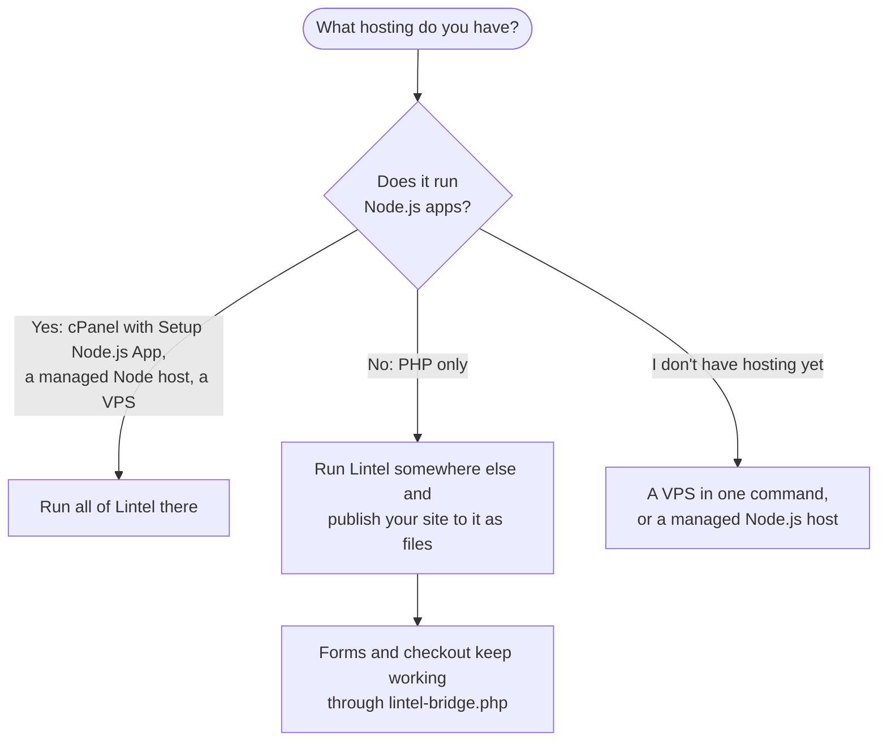

Lintel is a Node.js program. Wherever it runs, it serves your website, the admin and the
API from **one address and one port**, so any hosting that can run a Node.js app can run
all of Lintel. Hosting that only runs PHP can't, but it can still serve a site that Lintel
publishes as files.

## Not sure what your hosting can do?

Lintel has a checker for each case. Upload one file, open it, and it tells you in plain
English what will work and what to ask your host for.

- **`lintel-check.php`**: for any hosting with PHP. Upload it to your website's folder
  (`public_html` in cPanel) with File Manager and open `https://your-site/lintel-check.php`.
  It says **Run Lintel here**, **Publish your site here from Lintel**, or what to ask for.
- **`lintel-check.js`**: once you know Node.js is offered. It checks the Node.js version,
  memory, whether Lintel can save files and resize images, and internet access. See
  [step 1 of the cPanel guide](/hosting/cpanel/#1-check-your-hosting-can-run-lintel).

Both are in the hosting package (`pnpm build:hosting` puts them in `dist-hosting/`), and
neither changes anything on your hosting. Delete them when you have read the report.

## The three paths

### Your host runs Node.js apps: run all of Lintel

| Your hosting                                                | Follow                                                                            |
| ----------------------------------------------------------- | --------------------------------------------------------------------------------- |
| cPanel with **Setup Node.js App** (also Plesk, DirectAdmin) | [Install on cPanel hosting](/hosting/cpanel/)                                     |
| Railway, Render or Fly.io                                   | [Railway](/hosting/railway/), [Render](/hosting/render/), [Fly.io](/hosting/fly/) |
| A server you manage with Laravel Forge                      | [Deploy with Laravel Forge](/hosting/forge/)                                      |
| A Windows server                                            | [Run on Windows Server](/hosting/windows/)                                        |
| Your own VPS                                                | [A VPS in one command](/hosting/one-command/)                                     |

cPanel hosting can run Lintel **only when it offers "Setup Node.js App"** (CloudLinux's
Node.js Selector), under the Software section of cPanel. If you can't find it, ask your
host: _"Do you offer Setup Node.js App with Node.js 22?"_ Many hosts turn it on for free,
or on a slightly bigger plan.

### Your host only runs PHP: publish your site as files

Plain PHP hosting (no "Setup Node.js App") **can't run Lintel itself**: there is nowhere
for the Node.js program to run. You can still use it for your website:

1. Run Lintel somewhere else: on your own computer, or on a small VPS
   ([one command](/hosting/one-command/)) or managed Node.js host.
2. Publish your website from Lintel to your PHP hosting as plain files (by FTP, SFTP or a
   ZIP). Visitors get fast, static pages. See the **Publish your site as files** guide.
3. Upload `lintel-bridge.php` beside the files, so forms and checkout keep working: it
   passes them to your Lintel.

Editors use the admin on the Lintel you run elsewhere; the PHP hosting only serves pages.

### No hosting yet

- **Easiest to look after:** a managed Node.js host such as [Railway](/hosting/railway/)
  or [Render](/hosting/render/). No server to update; a few dollars a month.
- **Cheapest with full control:** a VPS (about $5 a month) and
  [the one-command installer](/hosting/one-command/), which sets up HTTPS for you.
- **You already use Docker:** [a VPS with Docker](/hosting/vps-docker/), step by step.

## What every option has in common

- Lintel answers on one port: `/` is your website, `/admin` the admin, `/api` the API.
  One proxy rule, or one Node.js app in a control panel, covers all three.
- It needs **Node.js 22 or newer** and **1 GB of memory** with the built-in database, or
  512 MB with a PostgreSQL database from your host.
- It needs no database server: the built-in database is used unless you choose Postgres
  in the setup wizard.
- HTTPS comes from whatever is in front: Caddy, your platform, or your host's AutoSSL.
