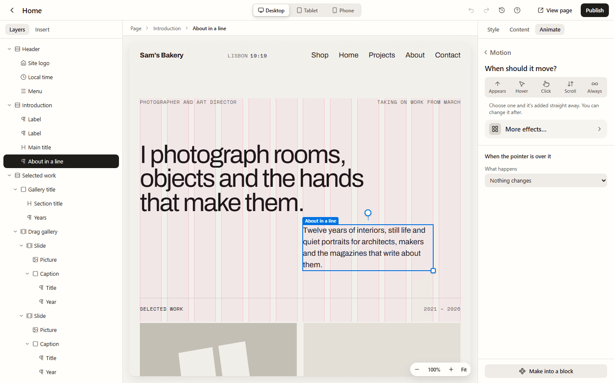
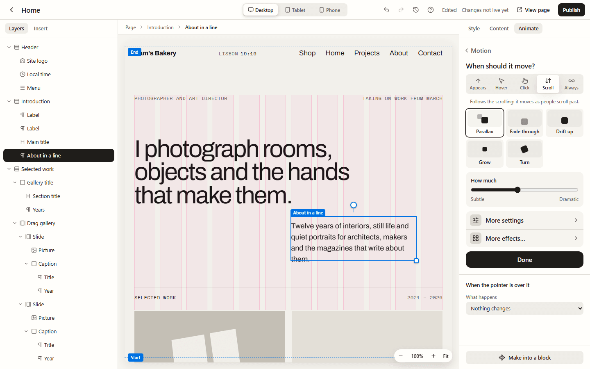

Any part of a page can move: a heading that rises into place as visitors scroll to it,
cards that arrive one after another, a button that presses in when it's clicked, a video
that grows as the page scrolls. You do it all in the page builder, on your own page,
without any code.

## Add motion

1. Select what should move: click it on the page, or pick it in **Layers**. It can be a
   single heading or picture, or a whole section.
2. Open **Animate**, on the right, and press **Add motion**.
3. Under **When should it move?**, choose a moment. Lintel adds a gentle motion straight
   away and plays it on your page:

| Moment      | When it plays                                                   | It starts with |
| ----------- | --------------------------------------------------------------- | -------------- |
| **Appears** | Once, the first time people scroll to it                        | Fade up        |
| **Hover**   | While the pointer is over it, or following the pointer          | Lift           |
| **Click**   | When it's clicked, tapped or dragged                            | Press          |
| **Scroll**  | As people scroll past: it moves with the scrolling              | Parallax       |
| **Always**  | All the time, for backgrounds, rows and loaders (use sparingly) | Breathe        |

4. To try another, press one of the small tiles under the moment. Each tile shows its
   movement as a tiny drawing. For **Appears**, they are Fade up, Fade in, Word by word,
   Slide in, Pop in and Blur in. Choosing another tile, or another moment, swaps the motion
   rather than adding more. Only tiles that suit what you selected are offered: **Word by
   word** is for text, **Underline** for text and buttons.
5. Adjust it with the few controls under the tiles: **How much**, **Speed**, **Feel**
   (smooth or springy) and, for **Appears**, **Starts** (straight away, or after a wait).
   Only the ones that mean something for that motion show.
6. Press **Done**.

**More effects…** opens the whole catalogue, with every ready-made animation and effect and
a search. **More settings** opens the full settings, with **Simple** and **Advanced** (the
timeline). [Animating your pages](/using/animating/) describes those, including everything
that can start an animation.

An element can have up to six animations. Motion is saved with the page like any other
change, and **Undo** takes it back one step at a time.

## Moving as people scroll

Choose **Scroll** for things that move with the scrolling: forwards as people scroll down,
backwards as they scroll up. The tiles are **Parallax**, **Fade through**, **Drift up**,
**Grow** and **Turn**.

While a scrolling motion is selected, two lines show on your page:

- **Start**: when the element reaches this line, the motion begins.
- **End**: when it reaches this line, the motion has finished.

Drag a line up or down to change where the motion starts and ends, or select it and use the
arrow keys. To start with, **Start** sits at the bottom of the screen and **End** at the top.

### Growing from small while scrolling

To make a video or picture grow as people scroll to it:

1. Select it, press **Add motion** and choose **Scroll**, then **Grow**.
2. Drag **How much**. Beside it, **Starts at** says how small it begins: from 90% of its size
   at **Subtle** down to a tenth at **Dramatic**. Screen readers read it out too.

It grows to its full size as it moves up the screen, and stays centred while it grows.

### Holding a section while things move

For a scene where the page stops while steps slide past, open **More settings**, then
**Advanced**, and tick **Hold it on screen while scrolling**. See
[Scroll scenes](/using/animating/#scroll-scenes).

## When the pointer is over it

Under the motion, **When the pointer is over it** changes the cursor over this element. It
only matters if your site has a custom cursor, or for a word or picture that follows the
pointer. See [Motion across the site](/using/site-motion/#over-one-element).

## The timeline

Open **More settings** and choose **Advanced** for the timeline, where you can drag
keyframes, change the easing curve and build scroll scenes. The moments, tiles and sliders
are enough for almost everything.

## On your website

When you publish, the page moves exactly as it did in the builder.

- **Only pages that move load anything extra.** A page with animations loads one small
  file (about 8 kB) that plays them; a page without animations loads no script at all.
- **Nothing is hidden for good.** Things that animate in are hidden only until their
  animation is ready. If the script can't load, they appear anyway after a moment, and
  visitors without JavaScript see the page as designed.
- **People who prefer less motion are respected.** If a visitor has asked their phone or
  computer to reduce motion, they see what you chose under **For people who prefer less
  motion**: just a gentle fade (the default), the end straight away, or no animation.

## Tips for tasteful movement

- Animate the few things that matter: the main heading, a row of cards, the button you most
  want pressed. If everything moves, nothing stands out.
- Keep entrances short. Most of the ready-made ones take well under a second.
- Use **Starts** (or **Wait before starting** in **More settings**) to make things arrive in order: the heading first, then the
  words under it, then the button.
- The templates' pages already have gentle animations. Look at them in **Animate** for ideas.
