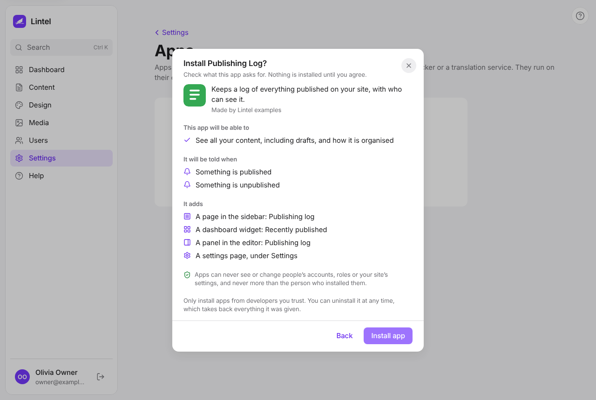

**Apps** are tools made by other developers that work with your site: a stock checker, a
translation service, a booking system. They run on their own servers, not inside Lintel,
and they only get the access you approve. Admins manage them in **Build → Apps**.

## Adding an app

The app's developer gives you one of two things: a web address (it usually ends in
`lintel-app.json`), or a block of text to paste.

1. Open **Build → Apps** and press **Add an app**.
2. Choose **A web address** or **Pasted details**, enter what the developer gave you, and
   press **Continue**.
3. Read what the app asks for (see below). Nothing is installed yet.
4. Press **Install app** if you are happy with it.
5. Lintel shows a **Client ID** and a **Client secret**. Copy both into the app, usually on
   its own settings page, or send them to its developer by a safe route. The secret is
   shown only once.

If Lintel says it couldn't read the app's details, check the address with the developer.
If it lists things to fix in the app's details, send that message to the developer: it is
written for them.

## What an app may do

Before you install, Lintel shows three lists in plain words:

- **This app will be able to**: for example "See all your content, including drafts" or
  "Upload, change and delete images and files". An app that asks for nothing can still show
  its own pages, but can't read or change your site.
- **It will be told when**: things that happen on your site that the app hears about, such
  as "Something is published".
- **It adds**: pages, dashboard widgets and panels it shows inside Lintel.

Some things an app can never do, whatever it asks for:

- See or change people's accounts, roles, or your site's settings.
- Do more than the person who installed it. If you can't publish, an app you install
  can't publish either, even if it asked to.
- Change its own access later. If the app is updated and wants more, it has to be
  installed again, and you see the new list first.

Only install apps from developers you trust: an app that may read your content can copy it.

## Using an app

Depending on the app, you'll find:

- a new item in the **sidebar**, under Media;
- a **widget** to add to your dashboard (press **Edit dashboard**, then **Add widget**);
- a **panel** beside the entry you are editing, sometimes only for some kinds of content;
- a row in **Settings**, under Apps, for its own settings.

These parts are shown in a protected frame: the app can see who is looking and what you are
editing, but nothing else in Lintel. Messages it shows always start with its name. If an
app's part says the app isn't responding, the app's server may be down; ask its developer.

## Removing an app

Open **Build → Apps**, choose the app and press **Uninstall**. It stops working
straight away: its access, its pages, widgets and panels, and what it was told about all
go. Your content stays as it is.

If an app's client secret might have been seen by someone else, uninstall the app and
install it again: it gets a new secret and the old one stops working.
