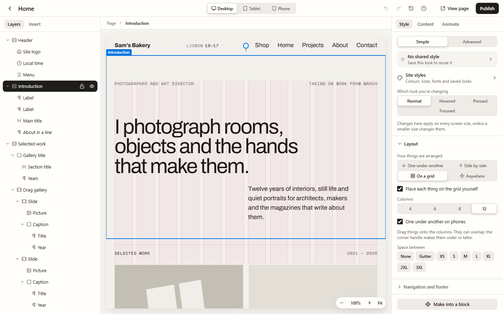

Sections, boxes and containers hold other things: headings, pictures, buttons, more boxes.
One control decides how they're arranged inside.

## How things are arranged

1. Select a section, box or container, on the page or in **Layers**.
2. Open **Style**, then **Layout**.
3. Under **How things are arranged**, choose one:

| Choice                | What it does                                                        |
| --------------------- | ------------------------------------------------------------------- |
| **One under another** | A column, top to bottom. Most sections start like this.             |
| **Side by side**      | A row, left to right.                                               |
| **On a grid**         | Equal columns, filled in order, or with each thing placed by hand.  |
| **Anywhere**          | Drag things wherever you like, even over each other, like a poster. |

**Anywhere** is only offered on sections, boxes and containers. It has a page of its own:
[Placing things anywhere](/using/free-layout/).

The settings for your choice sit under it:

- **Where things sit** lines things up, using a small square of dots: top left, middle,
  bottom right and so on.
- **Space between** sets the gap, using your theme's sizes (or your own, from
  [Site styles](/using/site-styles/)).
- **Wrap onto new lines** (side by side) lets things move onto a new row when there's no
  room.
- **Columns** (on a grid) says how many columns there are.

A closed **Layout** group sums it up, such as "One under another · gap L" or "On a grid · 3
columns".

## Placing things on a grid yourself

For magazine-like layouts (a picture across columns 2 to 6 with its text in 8 to 11, a
heading over the corner of a photo), place each thing on the grid by hand:

1. Choose **On a grid** and tick **Place each thing on the grid yourself**.
2. Choose 4, 6, 8 or 12 **Columns**.
3. Drag something inside the section. The columns show while you drag, and the cells it
   would take are shaded and labelled ("5–7").
4. Drag the corner handle to make it wider or taller.

From the keyboard, the arrow keys move the selected thing one column or row; with
**Shift**, they make it bigger or smaller.

Things can overlap. **To the front** and **To the back**, in **Where it sits**, decide what's
on top. The order in **Layers** stays the order screen readers and keyboards follow, so keep
it making sense from top to bottom.

With one thing selected, **Where it sits** shows its place in plain words: "Columns 2 to 6"
and "Rows 1 to 2". You can type the numbers there too. **Exact values** shows the grid's own
CSS for those who want it.

## Each screen size

Places on a grid are kept for each screen size, like any other style. Pick **Tablet** or
**Phone** at the top, then drag things to where they look best at that size.

**One under another on phones** is ticked to start with: on phones, everything in the
section stacks in the order it has in **Layers**, which suits most layouts. To place one
thing by hand on phones too, choose **Phone**, select it, and press **Place it on phones
too**. **Back to one under another** undoes that.

## Zooming the page

The pill in the bottom corner of the page zooms it:

- **−** and **+** zoom out and in. The percentage shows how far; press it to go back to
  actual size.
- **Fit** fits the whole width of the page in the space.
- **Ctrl** (or **⌘**) with the mouse wheel, or a pinch on a trackpad, zooms where the pointer
  is.
- **Ctrl +**, **Ctrl −** and **Ctrl 0** zoom in, out and back to actual size. **Shift 1**
  fits.
- When you've zoomed in past the space, hold **Space** and drag to move around the page.

Zooming never changes your design: the page keeps its width, so what you see at 50% is the
same layout, only smaller.

## Pages made before

Pages made with an older version of Lintel look exactly as they did. A section that used
the old "Normal" layout shows as **One under another**, and nothing about it changes until
you change one of its settings.

## For developers

The four choices are plain CSS: `display: flex` with a column or a row, `display: grid`, and
absolute positions for **Anywhere**. A placed grid sets `grid-column` and `grid-row` on each
thing, per screen size, in media queries. See `docs/decisions/0035-editorial-layouts.md` and
`docs/decisions/0046-one-builder-for-everyone.md`.
