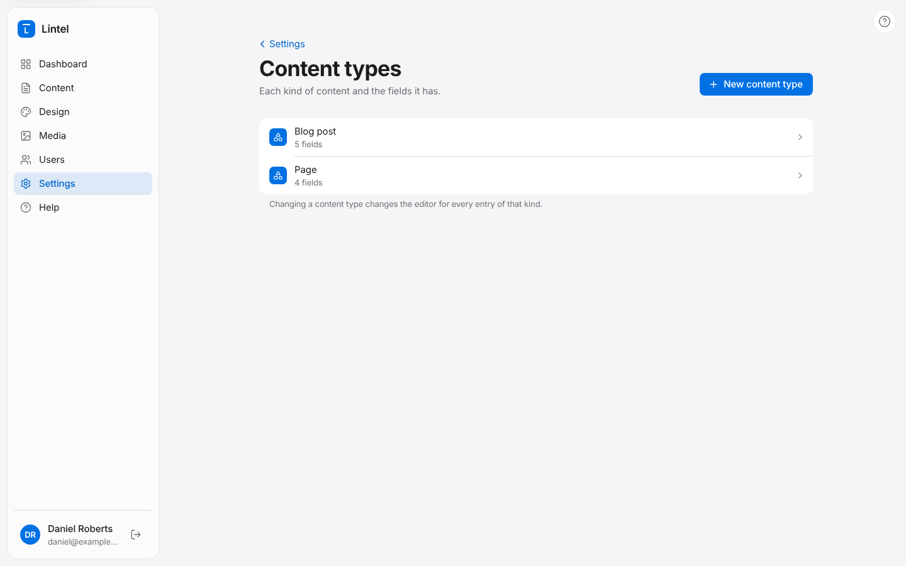
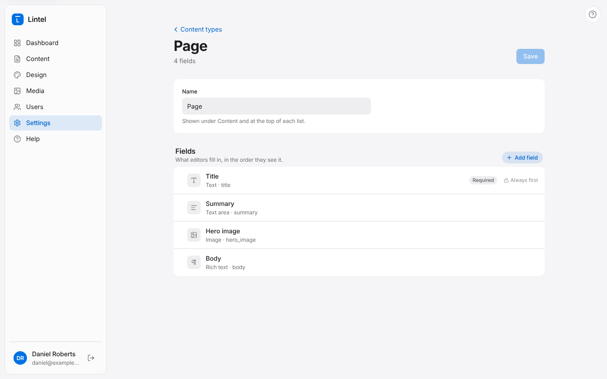

A content type is a kind of content and the fields it has. Every site starts with
**Pages** (title, summary, hero image and body). The Blog feature adds **Blog posts**
(title, excerpt, featured image, body and category). You can change these and add your
own, such as Recipes, Team members or Case studies.

Find them in **Settings**, then **Content types**. You need an administrator account to
change them.

## Making a new content type

1. Press **New content type**.
2. Give it a **name**, in the plural: "Recipes".
3. Choose how its entries are organised:
   - **Pages with parents and children**, like a site's main pages.
   - **Posts by date**, newest first, like a blog.
   - **A simple list** in an order you set, like team members.
4. Check the address its entries will live at, then press **Create and add fields**.

## Adding fields

Every content type starts with a **Title**. Press **Add field** and pick a kind of field
(the descriptions say what each is for). Then give it:

- a **label**, which is what editors see, like "Cooking time";
- optional **help text** shown under it, like "In minutes";
- **Required** if it must be filled in before publishing.

Some fields have more settings: a Select needs its **choices**, a Date can **include a
time**, and a Select can **allow more than one choice**.

Drag fields to change the order editors see them in, then press **Save**.

## Things to know before changing a content type

- Changing a content type changes the editor for **every** entry of that kind.
- Each field has a **handle**, the name its content is stored under (`cooking_time`). A
  saved field's handle doesn't change when you relabel it, so existing content isn't lost.
- If your website has been built to show a field, check with your developer before
  removing or renaming it.
