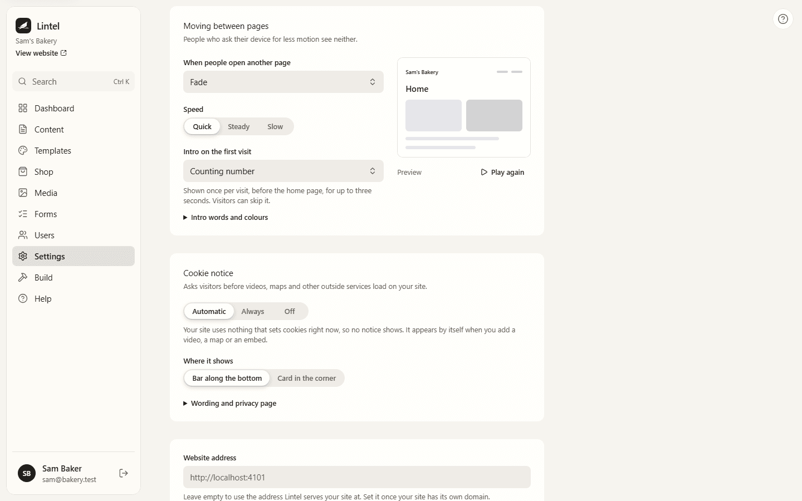

Videos from YouTube or Vimeo, maps, embeds and Adobe Fonts come from other companies, and
they may set cookies. Privacy laws in the UK, the EU and elsewhere expect a site to ask
first. Lintel does this for you: when your site uses one of these, visitors see a small
notice, and nothing from those companies loads until they say yes.

Sites that use none of them show no notice and load none of its code.

## What visitors see

The notice names what your site uses, for example: "This site uses OpenStreetMap and
YouTube, which may set cookies. Nothing from them loads until you say so." It has three
buttons:

- **Accept all** loads everything straight away, without reloading the page. Videos don't
  start playing by themselves.
- **Only necessary** keeps each video or map behind its own placeholder. Visitors can still
  load just that one.
- **Choose** shows a switch for each service.

**Accept all** and **Only necessary** look the same, so neither is pushed. The notice sits
at the edge of the page: it never covers what visitors are reading, never takes the
keyboard's focus, and follows your theme's fonts, colours and light or dark mode.

The choice is remembered in the visitor's browser (not in a cookie) for about six months.
If your site starts using a new service, visitors are asked again.

## Changing your mind

Visitors can reopen their choices with **Cookie settings**. It's in the automatic footer,
the footers in the section library, and the Studio, Atelier and Folio footers. If you built
your own footer, add the **Cookie settings** element from **Insert**. It only shows on
sites that have a notice.

## Settings

Go to **Settings**, then **Your website**, and find **Cookie notice**.

- **Automatic** (recommended) shows the notice only while your published site uses
  something that needs it. The settings say whether it does right now.
- **Always** shows it whatever your site uses. Choose it if you've added a Code element, or
  an embed set to load without asking: Lintel can't tell what those load.
- **Off** never shows it. Lintel warns you plainly first.
- **Where it shows**: **Bar along the bottom** or **Card in the corner**.
- **Wording and privacy page**: your own heading and message (write `{services}` where the
  list of services should go), and a page of your site to link to, such as your privacy
  policy.

Press **Save changes**. The settings are shared by every site in your Lintel; each visitor's
choice is kept for each site.

This page is general guidance, not legal advice. If you're unsure what your site needs, ask
someone who knows the law where you work.

## What Lintel looks for

Lintel reads your published site: its pages, its navigation and footer, its blocks and its
fonts. It counts:

- **YouTube** and **Vimeo** videos;
- **maps** (Lintel's Map element uses OpenStreetMap);
- **embeds** from other sites;
- **Adobe Fonts**: until a visitor accepts, your site shows your theme's own fonts;
- add-ons that say they need consent, such as [Visitors](/using/visitors/) when it's set to
  count only people who accept.

Fonts from Google Fonts don't count: Lintel serves them from your own website. See
[Fonts](/using/fonts/).

## For developers

The notice is a separate script, sent only to sites that need it. Plugins list their
services with `consentServices`; their scripts ask `window.lintelConsent.allows(id)` and
listen for the `lintel:consent` event. In Liquid templates, `` draws
the link. See `docs/decisions/0040-cookie-notice.md`.
