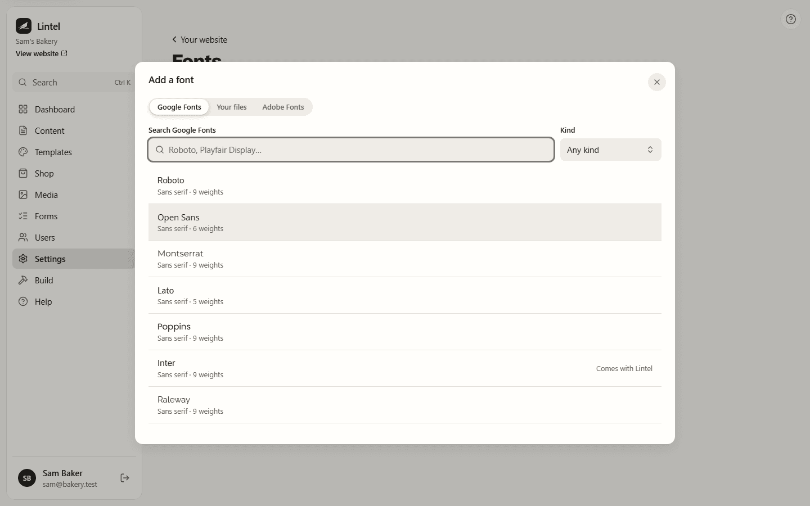

Each site has one list of fonts. Every page can use them, and so can the site's headings
and body text. Fonts come from three places: Google Fonts, your own font files, and Adobe
Fonts.

Lintel also includes 23 fonts, such as Inter, Lora and Bebas Neue. They are always there,
without adding them.

## Adding a font

1. Go to **Settings**, then **Your website**, and press **Manage fonts**. (In the page
   builder, **Add a font** at the bottom of the font list opens the same window.)
2. Press **Add a font**.
3. Choose **Google Fonts**, **Your files** or **Adobe Fonts**, and follow the steps below.

A site can have up to 40 fonts. To add fonts you need permission to change settings.
Everyone who can design pages can use them.

### From Google Fonts

1. Search by name, or pick a **Kind** (sans serif, serif, display, handwriting or
   monospace). Each font is shown in its own letters. Popular ones come first.
2. Choose a font, then its **Weights**. Regular and Bold are ticked to start with. Tick
   **Italics too** if you want them.
3. Press **Add** and the font's name.

Lintel downloads the files to your server and your website serves them itself. Your
visitors' browsers never contact Google, so Google Fonts don't need a cookie notice. The
files are kept in the media library, so they are in your backups too. Removing the font
removes the files.

### From your own files

1. Press **Choose font files**, or drop the files on the window. Use WOFF2, TTF or OTF files,
   one for each weight and style. You can add several at once.
2. Lintel reads each file's name, weight and style. If it can't, it guesses from the file
   name and says **Guessed from the file name**. Change anything that's wrong.
3. Tick **My licence lets me use this font on a website**. Lintel keeps a note of who ticked
   it, and when.

Only add fonts your licence lets you use on a website.

### From Adobe Fonts

1. In Adobe Fonts, open **Web projects** and copy the project's ID (it looks like
   `abc1def`).
2. Paste it into **Web project ID** and press **Connect**. Lintel lists the project's fonts.
3. In Adobe Fonts, add your website's address to the project. Without it, the fonts won't
   show on your site.

Adobe's licence means Adobe serves these fonts, not your website. Because they come from
another company, your [cookie notice](/using/cookie-notice/) asks visitors first. Until they
accept, your site shows your theme's fonts instead.

## Using your fonts

- **For the whole site:** in **Settings**, then **Your website**, choose **Headings** and
  **Body text** under **Fonts**. A font chosen here takes the place of the pairing's. Pick a
  pairing again to go back to its fonts.
- **On one element:** in the page builder, select it, open **Style**, then **Text**, and
  pick from the font list. It is grouped: the theme's fonts, your site's fonts, fonts added
  to this page only, and the fonts included with Lintel.
- **By name:** in [Site styles](/using/site-styles/) you can name fonts by their job, such as
  **Display** or **Text**, and use those names everywhere.

A font that a page uploaded for itself, before site fonts existed, keeps working. The font
list offers **Use it on every page** to move it to the site.

## When the server is offline

Google Fonts and Adobe Fonts need the server to reach the internet while you add a font.
Without it, those tabs say so. Your own files and the included fonts work offline.

## On a site with several sites

Each site in one Lintel has its own list of fonts, as it has its own menus. See
[Running several sites](/using/sites/).

## For developers

Fonts are stored per site in the `site_fonts` table. Google Fonts are fetched through
Fontsource's open API and served as Latin and Latin Extended WOFF2 files with
`@font-face`. Adobe Fonts are linked through the project's stylesheet at `use.typekit.net`.
The reasoning is in `docs/decisions/0037-site-fonts.md`.
