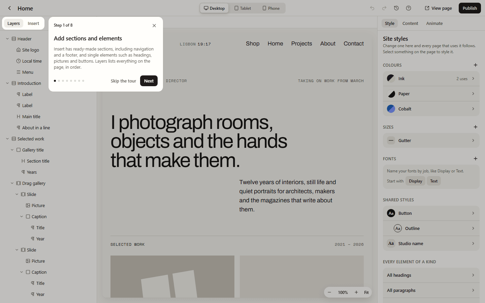

Everyone gets the same page builder, with every setting in it. There are no skill levels
to choose: a beginner and a designer see the same screen. It stays calm by showing the
settings people change most and folding the rest away until you ask for them:

- **Style** opens with a few friendly groups (layout, spacing, text). **Simple** and
  **Advanced**, at the top, switch between those and every setting: size, position,
  borders, shadows and more.
- **Animate** starts with **Add motion**: choose when something should move, and a gentle
  motion is added straight away. **More settings** opens the rest, and **Advanced** there
  opens the timeline, where you can drag keyframes and build scroll scenes. See
  [Animating in the builder](/using/animating-in-the-builder/).
- Groups you close stay closed, and the builder remembers which ones you use.

Developers who want to work in code use the site's Liquid templates in their own editor
(such as VS Code) with `lintel templates init` and `lintel templates sync`. People with
permission to write code can also add a **Code** element from **Insert** and edit its HTML,
CSS and JavaScript in **Content**.

## The guided tour

The first time you open the builder, a short tour of nine steps shows you around:

1. **Add sections and elements:** **Insert** has ready-made sections, including a
   navigation and a footer, and single elements. **Layers** lists everything on the page.
2. **Click to select, double-click to type.**
3. **Change how it looks:** **Style**, and choosing which look you're changing (as it
   normally is, hovered or pressed). See [Site styles](/using/site-styles/#which-look-youre-changing).
4. **Styles for the whole site:** **Site styles** and shared styles. See
   [Site styles](/using/site-styles/).
5. **Arrange what's inside:** **Layout** puts things one under another, side by side, on a
   grid, or anywhere. See [Arranging things](/using/arranging-things/).
6. **Make it move:** **Animate** and **Add motion**.
7. **Every screen size, and every step:** desktop, tablet and phone, **Undo** and
   **History**.
8. **Design and Content:** the switch at the top moves between the builder and the page's
   fields and settings. See [The content tree](/using/content-tree/#one-page-two-views).
9. **Publish and view your page:** **Publish** and **View page**.

Each step dims the rest of the screen so the part it's about stands out. Press **Next** to
go on, **Back** to look again, or **Skip the tour** (or Escape) to start straight away.
Focus stays in the tour's card while it's open, so it works with the keyboard and screen
readers, and it doesn't move about if your device asks for less motion. The tour shows once;
your browser remembers that you've seen it.

To see it again, press **Help and tips** (the question mark at the top) and choose **Replay
the tour**.

## Tips

The first time you open **Style** or **Animate**, a short tip shows how to get more out of
it. Press **Got it** to close one. **Help and tips**, then **Show tips again**, brings them
all back.
