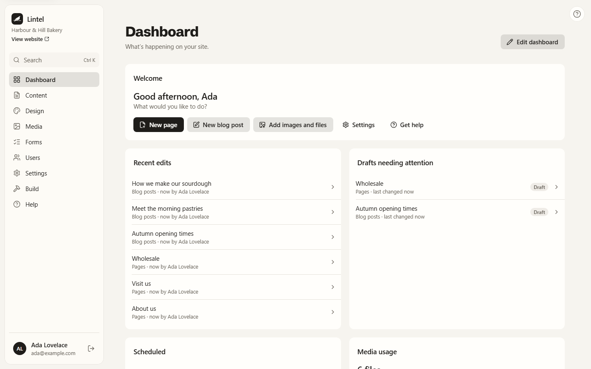
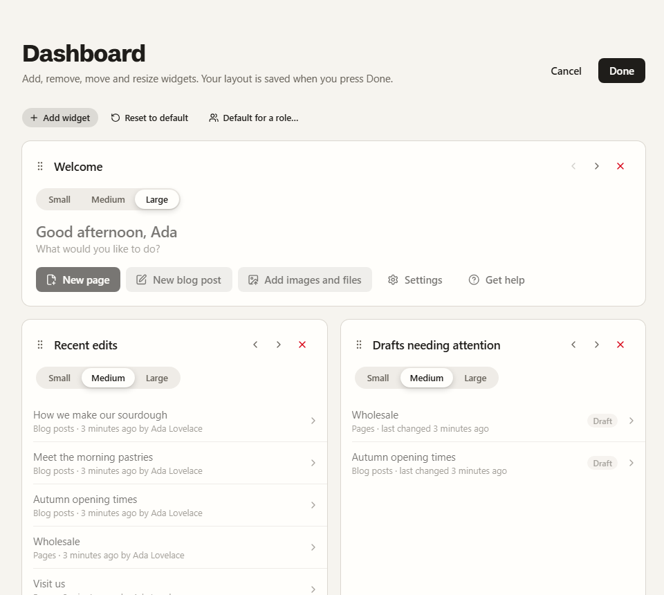
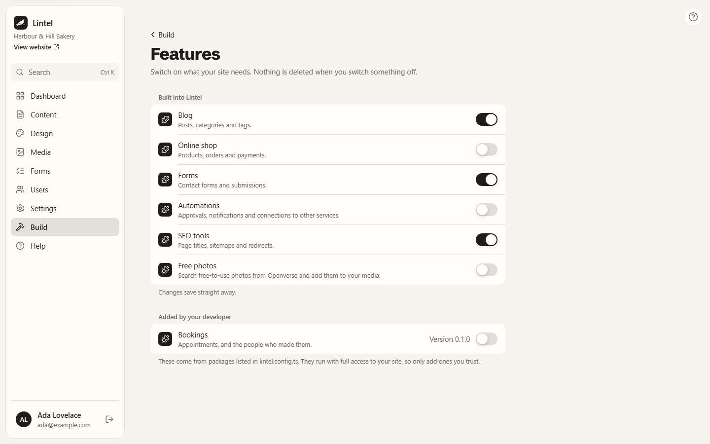
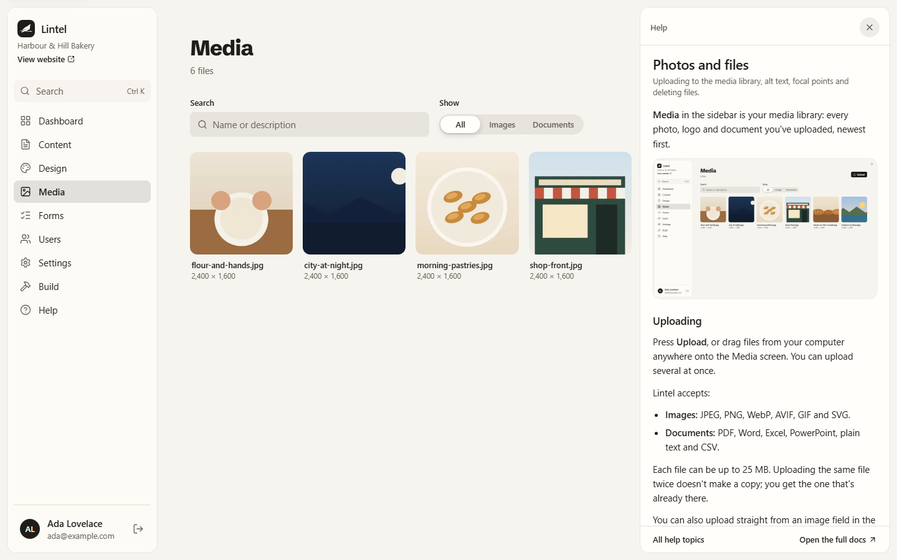

## The sidebar

The sidebar on the left lists the parts of Lintel you can use. What you see depends on
your account and on the features switched on for your site, so not everyone sees every
item.

| Section       | What it's for                                                    |
| ------------- | ---------------------------------------------------------------- |
| **Dashboard** | Your starting point: recent edits, drafts and what's scheduled.  |
| **Content**   | Your pages, posts and anything else you write.                   |
| **Media**     | Photos, logos and documents.                                     |
| **Settings**  | How your site and its content are set up, such as content types. |
| **Help**      | These help pages, inside Lintel.                                 |

Features your site has switched on, such as Forms or Bookings, add their own items
after Media. Design, Shop, Forms and Users are on the way. Their sections show "On
the roadmap" for now.

Your name is at the bottom of the sidebar. The button beside it signs you out.

## Your dashboard

The dashboard is yours to arrange. Press **Edit dashboard**, then:

- **Add widget** to choose from the widgets you can use, each with a line about it.
- Drag a widget by its handle, or use its **‹** and **›** buttons, to move it.
- Pick **Small**, **Medium** or **Large** to change how much room it takes.
- Press **×** to take it off. You can add it again later.

Press **Done** to keep your changes, or **Cancel** to forget them. **Reset to default**
puts back the dashboard your admin set up for your role (or Lintel's own). Your layout is
saved to your account, so it is the same on any computer.

Some features add tabs above the dashboard, such as **Bookings this week**. **Overview**
is always your dashboard.

## Switching features on and off

Admins choose which parts of Lintel a site uses in **Settings → Features**. Switching a
feature off hides it from everyone and keeps everything it made, so switching it back on
brings it all back as it was.

## Getting help

Every screen has a **?** button at the top right. It opens the help for the screen you're
on, beside your work, so you can read and carry on. The help is built into Lintel, so it
works without an internet connection. **Open the full docs** takes you to these pages.

## Light and dark

Lintel follows your computer's setting for light or dark mode. Change it in your
computer's display settings and Lintel changes with it.

## Using the keyboard

Everything in Lintel works with the keyboard. Press <kbd>Tab</kbd> to move between
buttons and fields; the one you're on is outlined. On any screen, the first
<kbd>Tab</kbd> shows a **Skip to content** link that jumps past the sidebar.
