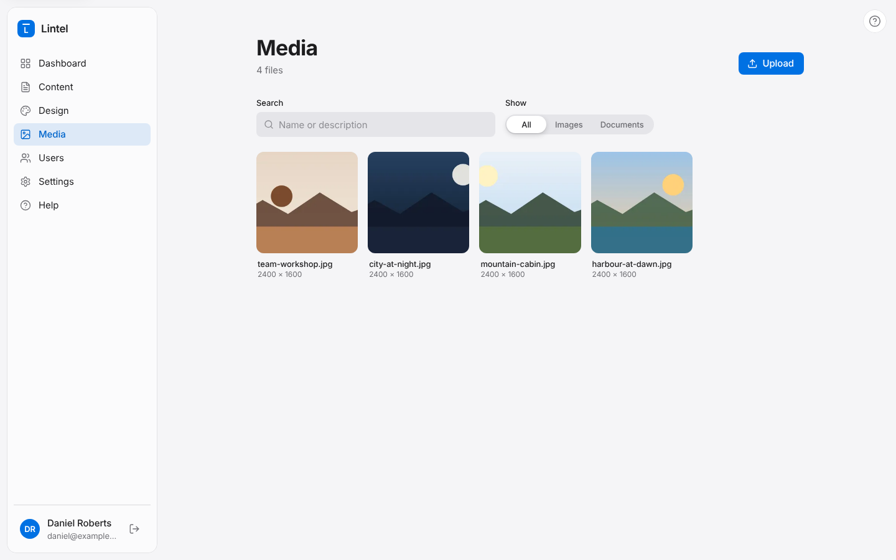
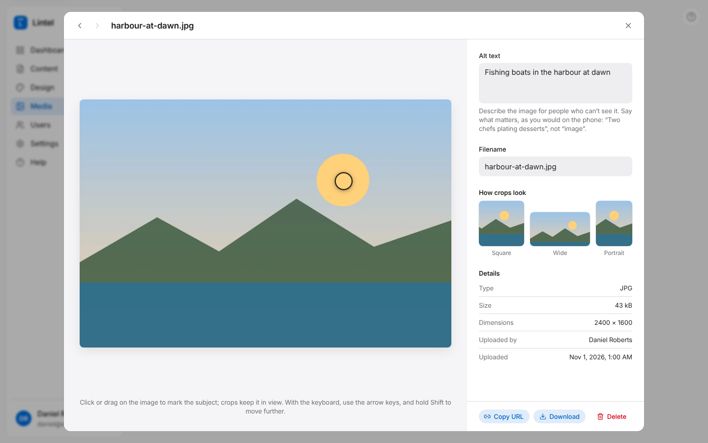

**Media** in the sidebar is your media library: every photo, logo and document you've
uploaded, newest first.

## Uploading

Press **Upload**, or drag files from your computer anywhere onto the Media screen. You can
upload several at once.

Lintel accepts:

- **Images:** JPEG, PNG, WebP, AVIF, GIF and SVG.
- **Documents:** PDF, Word, Excel, PowerPoint, plain text and CSV.

Each file can be up to 25 MB. Uploading the same file twice doesn't make a copy; you get
the one that's already there.

You can also upload straight from an image field in the editor: press **Choose image**,
then **Upload new**.

## Describing a photo (alt text)

Click a photo to open its details. Under **Alt text**, describe the photo for people who
can't see it, as you would on the phone: "Two chefs plating desserts", not "image".
Screen readers read it aloud, and search engines use it too. It's saved as you type.

## Marking the subject (focal point)

Your site may show the same photo in different shapes: square in a list, wide at the top
of a page. Lintel crops it to fit, and the **focal point** tells it what to keep in view.

Click or drag on the photo to put the focal point on the subject, such as a face. **How
crops look** shows the square, wide and portrait versions as you move it. With the
keyboard, use the arrow keys, and hold <kbd>Shift</kbd> to move further. **Centre** puts
it back in the middle.

## Finding a file

Use **Search** to find files by name or alt text, and **Show** to see only images or only
documents.

## Sharing or downloading

In a file's details, **Copy URL** copies its web address and **Download** saves the
original to your computer. Anyone with the address can open the file, so don't upload
anything private.

## Deleting a file

Open the file and press **Delete**. If a page or post still uses it, Lintel tells you
which ones; remove it from those first. Deleting can't be undone, and the file's address
stops working on your site.
