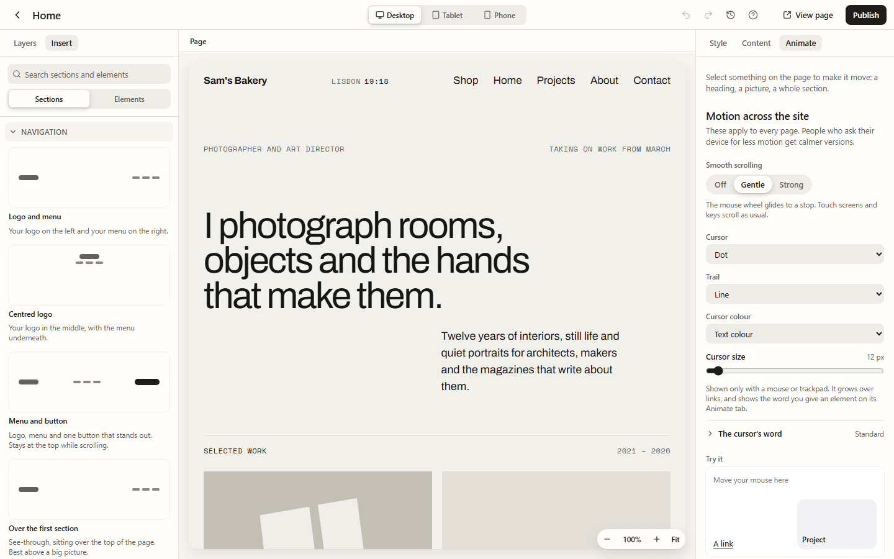
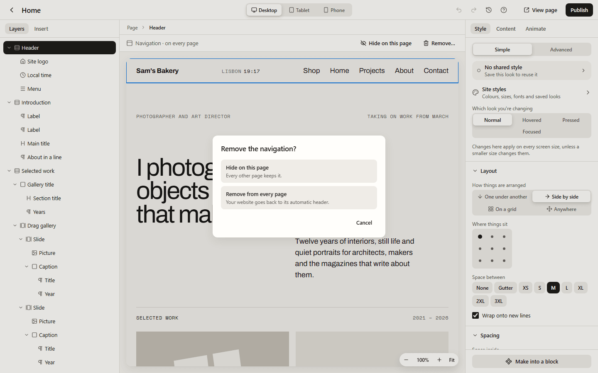

Your site's navigation (the bar with your logo and menu) and its footer are sections you
add once. They then show on every page, in the same place. Change them on any page and
every page follows.

## Adding a navigation or a footer

1. Open any page in the page builder.
2. Open **Insert**, then **Sections**, and open the **Navigation** or **Footer** group.
3. Press the one you like:
   - **Navigation:** Logo and menu, Centred logo, Menu and button, Over the first section,
     or Logo and Menu button.
   - **Footer:** Simple footer, Footer with columns, Centred footer, One-line footer or Big
     name footer.
4. Press **Publish**. The navigation or footer goes on every page of your website.

The first time you add one, a note says it takes the place of your site's automatic header
(or footer) on every page when you publish, with **Undo** in case you didn't mean to.

The links come from your site's **Main menu** (in **Content**, then **Menus**). To show a
different menu, select the menu and choose **Which menu** in **Content**. The **Site logo**
shows your logo, or your site's name if you have no logo, and links to your home page.

On tablets and phones the menu folds into a **Menu** button. It opens the menu over the
page, and Escape or **Close** shuts it again.

A site has one navigation and one footer. Adding another one replaces it.

## Editing it once, for every page

Click the navigation or footer on any page and change it like anything else: its words,
its links, its colours, its motion. A strip above the page says **Navigation · on every
page** (or **Footer · on every page**) while it's selected, so you know the change is for
the whole site.

## Waiting for Publish

Changes to the navigation and footer wait until you press **Publish**, just like changes to
a page. Until then, visitors see the navigation and footer as they were. The top bar says
**Navigation and footer changes not live yet** while some are waiting.

**Publish** puts the page live and then any waiting navigation and footer changes, so one
press does both. If you change something back to how it was, there's nothing left to
publish and the note goes away.

The **Preview** of a page that isn't published yet still shows the published navigation
and footer.

## Hiding it on one page

Some pages are better without a navigation or footer, such as a landing page for an
advert. To hide it on one page:

- select it and press **Hide on this page** on the strip above the page, or
- with nothing selected, open **Content** and untick **Show the site's navigation** or
  **Show the site's footer** under **On this page**.

Every other page keeps it. Tick the box again to bring it back.

## A page with its own navigation

Sometimes one page needs a navigation of its own. Build it as an ordinary section at the
top of the page and select it. At the bottom of the panel on the right, open **Navigation
and footer** and press **Use as this page's own navigation**. It becomes that page's navigation, and the site's
navigation is hidden there, so the page never shows two.

When a page already starts with a menu or a row of links, the builder asks for you: **This
page starts with its own menu. Use it as this page's navigation?** Press **Use as this
page's navigation**, or **Not now**.

The same group has **Use as the site's navigation** and **Use as the site's footer**, which
turn a section you designed yourself into the site's own.

## Removing it from every page

Select the navigation or footer and press **Remove…** on the strip above the page (or press
Delete in **Layers**). Lintel asks what you mean:

- **Hide on this page:** every other page keeps it.
- **Remove from every page:** it is taken off the site, and your website goes back to its
  automatic header (or footer).

**Undo** brings it back. Only people who may change the site's blocks see **Remove from
every page**; everyone else gets **Hide on this page**.

## Sites without one

A site that has never added a navigation keeps its automatic header: your site's name (or
logo) and the **Main menu**. The same goes for the footer. Once you add one, the automatic
one is gone from every page, and the builder says so. New sites, and sites started from a
template, start with the **Logo and menu** navigation and the **Centred footer**, so nobody
publishes a site without a menu.

The **Centred footer** has a language switcher. It only shows on a site in more than one
language.

## Starter templates

Studio, Atelier and Folio each bring a navigation and footer in their own look. When you
apply a template with its look, its navigation and footer replace yours straight away. See
[Templates](/using/templates/).

## Who can change them

Changing the navigation and footer needs the same permission as changing the site's blocks,
because it changes every page. Anyone who can design pages can still hide them on a page.

## For developers

The sections are kept per site, as a draft and a published copy in the settings table. The
website draws them outside `<main>`, after the skip link, as the page's banner and content
information landmarks, with the current page marked in the menu. In Liquid templates,
`` and `` draw them. See
`docs/decisions/0039-navigation-and-footer-sections.md` and
`docs/decisions/0048-shared-sections-wait-for-publish.md`.
