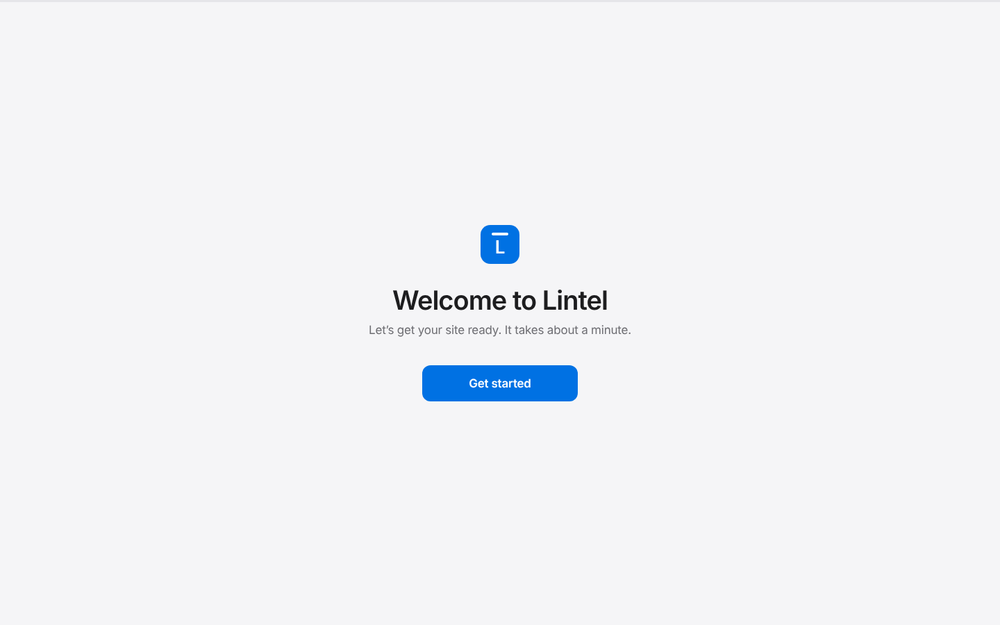
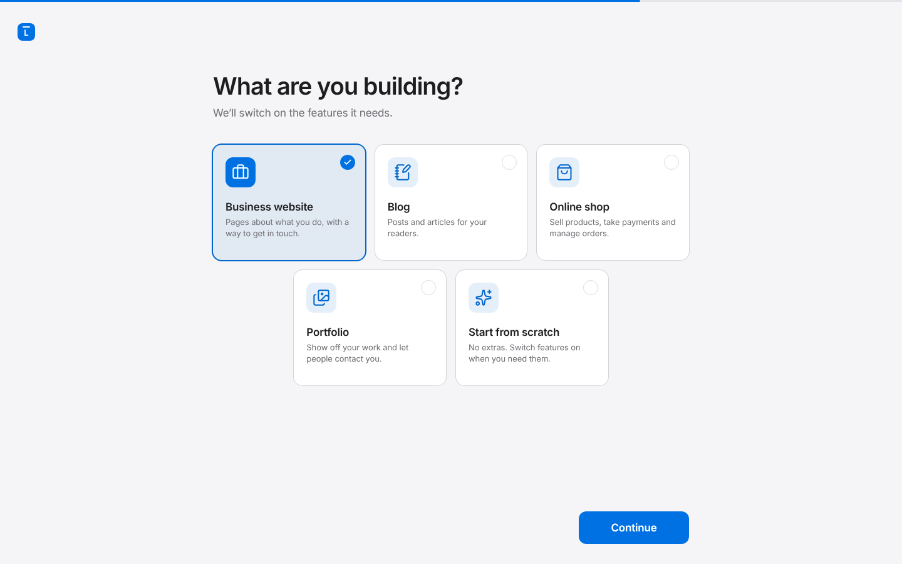

The first time you open Lintel in your browser, it asks a few questions. It takes about
a minute, and you can change most answers later.

## 1. The setup code (only sometimes)

If you're setting up Lintel on a server rather than your own computer, you'll be asked
for a **setup code**. It's the eight-digit number printed in the terminal where Lintel is
running, like `4821-0937`. It stops anyone else setting up your site before you do.

On your own computer you won't see this step.

## 2. Where to keep your content

- **Built-in** is the simplest choice. There's nothing to install, and your content is
  kept in a folder on the computer running Lintel. Good for trying Lintel and for small
  sites.
- **Your own PostgreSQL** is for live sites and teams. Fill in the server address, port,
  database name, username and password, then press **Test connection**. Tick **Create the
  database if it doesn't exist** and Lintel sets up an empty one for you.

If whoever installed Lintel has already chosen a database, this step is skipped.

## 3. Your account

Enter your name, the email address you'll sign in with, and a password of at least 12
characters. A short phrase of three words works well. This first account can do
everything, so keep the password safe.

## 4. What are you building?

Pick the closest match. Lintel switches on only the features that kind of site needs, so
a blog doesn't show an empty shop:

| You pick           | Features switched on          |
| ------------------ | ----------------------------- |
| Business website   | Forms, SEO tools              |
| Blog               | Blog, SEO tools               |
| Online shop        | Online shop, SEO tools, Forms |
| Portfolio          | Forms, SEO tools              |
| Start from scratch | None                          |

On the next screen you can switch any feature on or off before pressing **Finish
setup**. Every site gets a **Pages** content type; the Blog feature adds **Blog posts**.

## 5. You're all set

Press **Go to your dashboard** and you're in. Next: [find your way around](/using/getting-around/).
