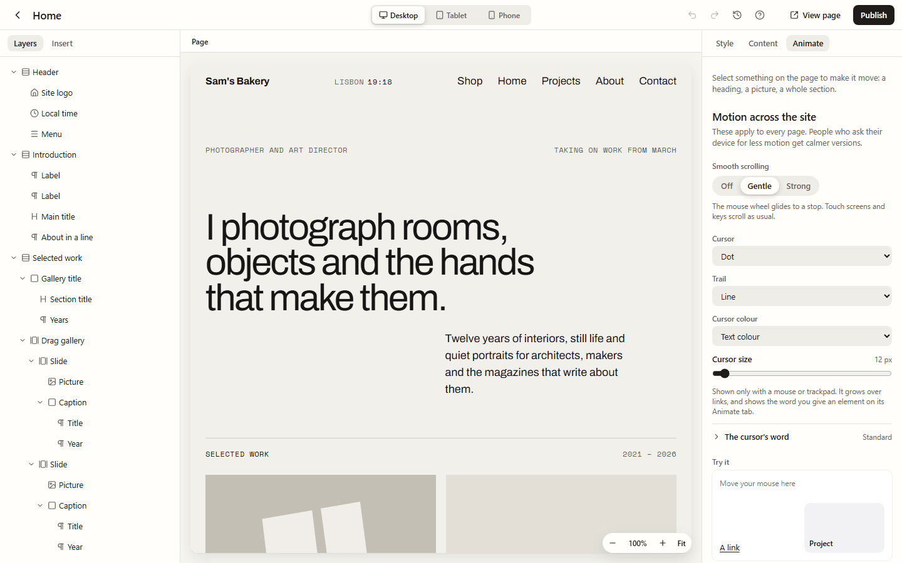

Some motion belongs to the whole site rather than to one element: how the page scrolls,
the cursor, how one page gives way to the next, and an intro before the home page. Each is
one choice, and each is off until you turn it on.

People who ask their device for less motion get calmer versions of all of these, or none.
Touch screens never see a custom cursor.

## Smooth scrolling and the cursor

In the page builder, select nothing (click the grey space beside the page, or press Escape)
and open **Animate**. **Motion across the site** is there.

### Smooth scrolling

**Smooth scrolling** makes the mouse wheel glide to a stop: **Off**, **Gentle** or
**Strong**. Touch screens, keys and the scrollbar scroll as usual, so nothing feels strange.
Sticky headers, scroll motion, find in page and links to part of a page all keep working.
It's off for people who ask for less motion.

### The cursor

**Cursor** swaps the arrow for something of your own, only for a mouse or trackpad:

- **Normal** (the browser's own), **Dot**, **Ring**, **Ring and dot** or **Inverting circle**;
- **Your own picture**: choose one from the media library (an SVG or a small PNG works
  best), its size (16 to 96 pixels) and where it points: the middle, or the top-left corner
  like an arrow. A picture over 64 KB gets a note, as it slows the page. Until you choose a
  picture, visitors keep the normal pointer.

Then choose a **Trail** (No trail, Dots, Line or Comet), a **Cursor colour** (your **Text
colour** or **Brand colour**, which suit light and dark mode, or **Pick a colour**) and a
**Cursor size**. The cursor grows over links and buttons. Fields keep the normal text
cursor, and keyboard focus rings stay as they are. A picture cursor never lags behind the
pointer and has no trail.

### The cursor's word

An element can put a word on the cursor, such as **View** over a project or **Drag** over a
gallery. **The cursor's word** (closed to start with) sets how that word looks across the
site:

- **Background** and **Letters**: **Automatic**, your site's own colours, the theme's
  colours, or one you pick. Automatic letters are chosen to read on the background.
- **Size**: Small, Medium or Large.
- **Shape**: Pill, Square or Circle.

**Try it**, under the settings, is a small sample: move your mouse over it to see the cursor
grow over a link and show its word over a card. You don't have to publish anything to try
it.

These settings apply to your live site as soon as you change them. Changing them needs
permission to change settings.

## Over one element

To change what the cursor does over one element, select it, open **Animate**, and choose
under **When the pointer is over it**:

| Choice                           | What visitors see                                              |
| -------------------------------- | -------------------------------------------------------------- |
| **Nothing changes**              | The site's cursor, as everywhere else                          |
| **A word on the cursor**         | A word such as View, Open, Drag, Play or Read, or your own     |
| **A picture follows it**         | A picture beside the pointer, like a studio's list of projects |
| **The cursor grows**             | The site's cursor gets bigger (needs a site cursor)            |
| **The cursor becomes a picture** | A picture of this element's own, with its size and point       |
| **The cursor hides**             | No cursor at all                                               |
| **The normal pointer**           | The browser's own, for text people want to select              |

Only the chosen option's settings show. A word can have its own look under **Change its
look**; anything left empty follows the site. A picture that follows the pointer is
decoration: screen readers skip it and clicks pass through it.

Over an embedded video or map, the cursor steps aside so the player's own controls work,
and comes back when the pointer leaves it.

## Page transitions and the first-visit intro

These are in **Settings**, then **Your website**, under **Moving between pages**.

- **When people open another page**: **Change straight away** (the default), **Fade**,
  **Rise**, **Sweep up** or **Settle**. Once you choose one, pick a **Speed**: **Quick**,
  **Steady** or **Slow**. Browsers that can't play it simply change page.
- **Intro on the first visit**: **No intro**, a **Counting number**, your **Site name**,
  your **Logo** or a **Simple line**. It shows once per visit, before the home page only,
  for up to three seconds. Visitors can skip it with its button, a click or any key, and the
  page is all there underneath, so search engines and screen readers read it as usual.
  **Intro words and colours** changes what it says and its colours.

The **Preview** beside them plays your choice on a small stand-in page. **Play again**
replays it. Press **Save changes** to put them on your website.

People who ask for less motion see neither.

To carry a picture from one page to the next, such as a project photo that grows into the
project page's big photo, give both pictures the **Carry across pages** effect with the same
name. See [Effects](/using/effects/).

## Starter templates

Studio, Atelier and Folio each come with their own site motion: Folio, for example, has
gentle smooth scrolling, a small dot cursor, the Fade transition and the counting intro.
Applying a template with its look gives its motion to your site. See
[Templates](/using/templates/).

## For developers

Smooth scrolling eases the page's real scroll position, so it doesn't break
`position: sticky` or scroll timelines, and it loads only when it's on. Page transitions are
the browser's cross-document view transitions, written as CSS. Each site keeps its own
motion settings. See `docs/decisions/0034-site-motion.md`,
`docs/decisions/0036-page-transitions-and-intro.md` and
`docs/decisions/0047-designing-the-cursor.md`.
