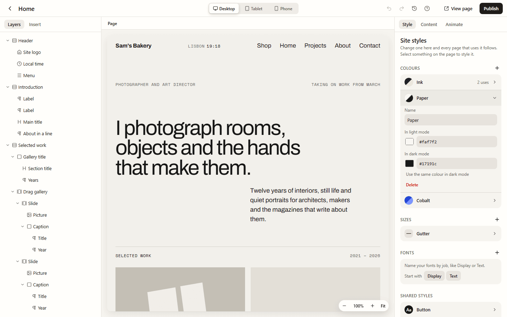
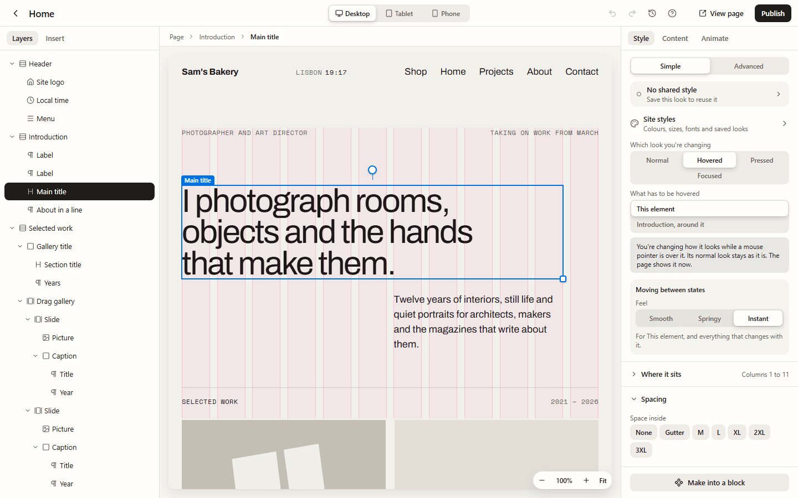

Site styles are the looks your whole site shares: its own named colours, sizes and fonts,
looks you've saved to reuse, and how every heading, link or button looks. Change one and
every page that uses it follows.

They're in the page builder, in the **Style** panel on the right:

- with nothing selected, **Style** shows them;
- with something selected, press **Site styles** (under the shared style) to open them over
  the element's style. **Back** returns to the element.

## Colours, sizes and fonts

Give your site's colours, sizes and fonts a name, such as **Ink**, **Paper**, **Gutter** or
**Display**, and use the name instead of the value. When you change the value, everything
that uses the name changes with it, on every page.

- **To add one,** press **+** beside **Colours**, **Sizes** or **Fonts**. An empty group
  offers a few to start with (Ink, Paper and Accent; Gutter, Section space and Reading
  width; Display and Text).
- **To change one,** press its row. You can rename it and change its value. Each row says
  how many times it's used.
- **To use one,** pick it where you'd pick any colour, size or font. Swatches, size chips
  and the font list show your site's own first, then the theme's. A closed group then shows
  the name with a small dot ("Text · Bold · Ink"), so you can see what's used at a glance.
- **To save one you picked by hand,** press **Save as a site colour** under the colour, or
  **Save as a size** under a size you typed. A size box that uses a name has **Unlink** to
  go back to a value of its own.

### Colours in dark mode

A colour can have a second value for dark mode. Open it and press **Add a dark-mode
colour**: Lintel suggests one, with the brightness turned round, and you can change it. On
your website, the colour follows the visitor's light or dark setting (or the one your
theme fixes, if it's set to **Light** or **Dark** in **Settings → Your website**). **Use the
same colour in dark mode** takes the second value off again.

This keeps text readable: a pale **Paper** background becomes dark at night, so the text on
it stays clear.

### Deleting one

Lintel asks first and says what will happen. If the name is used, its value is written into
the elements on this page, and into your shared styles, so they look exactly as before. On
this page that's a step you can undo. Pages that aren't open aren't changed; the warning
says so.

## Shared styles

A shared style is a look you save under a name, such as **Card** or **Button**, and reuse.
Change the shared style and every element that uses it changes, on every page.

1. Style an element the way you want it.
2. At the top of **Style**, press **No shared style · Save this look to reuse it**, then
   **Save this look…**, and give it a name.
3. To use it on another element, select that element, press the same row and pick the
   shared style from the list.

With a shared style in use, the row names it ("Button · 1 on this page") and asks where your
changes go:

- **Every Button** changes the shared style, everywhere it's used.
- **Only this one** keeps the change on this element, on top of the shared look.

The row also has **Rename**, **Make a variant** and **Detach** (which keeps the look on the
element as its own). A shared style holds how something looks, never where it sits.

### Variants

A variant is a shared style built on another one: **Outline** is a variant of **Button**.
It starts with Button's look and changes only what's different. Change Button and Outline
follows, except for what Outline changes itself.

Press **Make a variant** on the shared-style row and name it. The row then shows **Main ·
Outline** to switch an element between them. Deleting a base turns its variants into
shared styles of their own, with the look they had.

In Site styles, shared styles list their variants under them. **Select them** selects the
first element on this page that uses one, and outlines the others.

## Every element of a kind

Under **Every element of a kind**, set how all of one kind of element look across the site:
**All headings**, **All paragraphs**, **All links**, **All buttons** and **All pictures**.
Each opens the usual style controls. Links and buttons also have **Hovered**.

This is the bottom layer. An element's own style, and its shared style, always win. So you
can set every heading in your brand font, and still make one heading different. All
headings, paragraphs and links also reach the words inside rich text, such as blog posts.

## Which look you're changing

At the top of **Style**, **Which look you're changing** chooses which moment your changes
are for:

| Look        | When it shows                                                 |
| ----------- | ------------------------------------------------------------- |
| **Normal**  | Always, unless one of the others applies                      |
| **Hovered** | While a mouse pointer is over it                              |
| **Pressed** | While it's being clicked or tapped                            |
| **Focused** | When someone reaches it with the Tab key                      |
| **Open**    | Once its button opens it, like a card that shows more         |
| **Current** | When it's the page you're on, or the chosen tab (menus, tabs) |

**Open** and **Current** only show for elements they suit, such as accordions, menus, links
and tabs (**Advanced** shows them all). A tinted box under the choice says in a sentence
what you're changing, and the page shows that look while you work. **Moving between states**
sets how it changes over: **Smooth**, **Springy** or **Instant**.

### Following something around it

Usually a look is about the element itself. Sometimes it should follow something around
it: a picture that grows when its card is hovered, or a link's arrow that moves when the
whole row is.

1. Select the picture (or arrow) and choose **Hovered** (or **Pressed**, **Open** or
   **Current**).
2. Press **Change it when something around it is hovered…**.
3. Under **What has to be hovered**, choose the card, the row or another element around it,
   by name ("Introduction, around it"). Point at a name to see that element outlined on the
   page.

The list offers only things people recognise, such as cards, links, buttons, slides, tabs,
pop-ups and anything you've named, nearest first. **This element** goes back to the element
itself.

## Saving, undo and publishing

Site styles save as you work and apply to your **live website straight away**, on every
page, because they belong to the site rather than to one page. They aren't steps in the
page's **Undo**, but using, saving and detaching a shared style on an element are.

Each site in one Lintel has its own site styles. See
[Running several sites](/using/sites/).

## For developers

Colours, sizes and fonts are CSS custom properties (`--lintel-var-ink`) at the end of the
site's stylesheet, and colours with a dark value use `light-dark()`. Shared styles are
merged into each element's styles when the page is drawn, so there is no second class to
fight with. All headings, paragraphs and links are `:where(.lintel-design)` rules, as weak
as a tag. See `docs/decisions/0035-editorial-layouts.md` and
`docs/decisions/0038-reusing-styles.md`.
