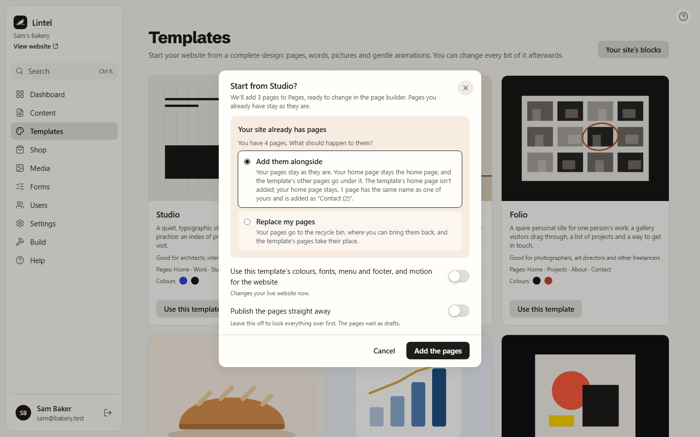

You don't have to start with a blank page. Lintel comes with nine complete website
templates, each with a home page and two or three others, its own words and pictures,
colours and fonts, and motion. Pick the one closest to what you do, then make it yours:
every word, picture, colour and animation can be changed.

| Template              | Good for                                           | Pages                                   |
| --------------------- | -------------------------------------------------- | --------------------------------------- |
| **Studio**            | Architects, interior designers and design studios  | Home, Work, Studio, Contact             |
| **Atelier**           | Furniture makers, ceramicists and other workshops  | Home, Collection, Craft, Visit          |
| **Folio**             | Photographers, art directors and other freelancers | Home, Projects, About, Contact          |
| **Bakery and café**   | Bakeries, cafés, delis and small restaurants       | Home, Menu, Our story, Visit us         |
| **Consultant**        | Consultants, coaches, accountants and advisers     | Home, Services, About, Contact          |
| **Portfolio**         | Designers, illustrators, photographers, studios    | Home, Work, About, Contact              |
| **Blog and magazine** | Writers, journals, newsletters, community groups   | Home, Sections, About, Newsletter       |
| **Local service**     | Plumbers, cleaners, gardeners, tutors, repairers   | Home, Services and prices, Book a visit |
| **Product landing**   | Apps, gadgets, subscriptions and launches          | Home, Features, Pricing                 |

## Studio, Atelier and Folio

These three are made for people whose website is part of their work. Each uses the
[editorial grid](/using/arranging-things/), its own [fonts](/using/fonts/), its own
[navigation and footer](/using/navigation-and-footer/) and
[motion across the site](/using/site-motion/).

- **Studio** is a quiet, typographic site for a design or architecture practice in
  Rotterdam. Its home page is an index of projects: pointing at a row shows the project's
  drawing beside the pointer and "View" on the cursor. It has a gallery visitors drag
  through, and a live clock with the studio's time. Space Grotesk and Inter, with one cobalt
  blue that has its own value in dark mode.
- **Atelier** is an editorial site for a furniture workshop: big serif type (Instrument
  Serif with Work Sans), a magazine grid of the collection, a long read about the craft and
  a visit page with opening hours and a live clock. Its home page holds still while three
  steps of making a chair slide past. Strong smooth scrolling, the workshop's name as an
  intro, and a ring-and-dot cursor.
- **Folio** is a spare personal site for one photographer's work: a large statement, a
  gallery visitors drag through, a list of projects that shows a frame from each as you
  point at it, and a large email address. Archivo with Space Mono, near-black on off-white,
  swapped round in dark mode. Gentle smooth scrolling, a small dot cursor, the Fade page
  transition and a counting intro.

Their words, people and places are made up, and their pictures are original drawings. Put
your own in their place.

## Start from a template

1. Go to **Templates** in the sidebar. You'll also find **Start from a template** on the
   last screen of setup.
2. Look through the templates. Each card shows its picture, who it suits, its pages and
   its two main colours.
3. Press **Use this template** on the one you like.
4. If your site already has pages, choose what should happen to them:
   - **Add them alongside**: your pages stay as they are. Your home page stays the home
     page, and the template's other pages go under it. A page with the same name as one of
     yours is added as, say, "Contact (2)".
   - **Replace my pages**: your pages go to the recycle bin, where you can bring them back,
     and the template's pages take their place.
5. Choose what else should happen:
   - **Use this template's colours, fonts, menu and footer, and motion for the website**
     gives your whole site the template's look. It says **Changes your live website now**,
     because it does. It starts off when you add the pages alongside your own, so your live
     site keeps its look, and on when you replace your pages or have none yet.
   - **Publish the pages straight away** puts the pages on your website at once. It's off at
     first, so you can look everything over; the pages wait as drafts until you publish
     them.
6. Press **Add the pages**. The dialog says how many pages it will add.

Lintel adds the pages to **Pages** and, if your **Main menu** is empty, adds a link to each
one. Then open any page and press **Edit design** on its **Design** card to change the words
and pictures in the page builder. When you're happy, press **Publish**.

You only see the options you're allowed to use. Someone who can't change the website's
look, or can't publish, still gets the pages, as drafts in your current colours.

### What the template's look changes

With **Use this template's colours, fonts, menu and footer, and motion** on, applying a
template changes, straight away on your live site:

- the theme's colours, its fonts for headings and body text, and its corners;
- the template's own named colours and sizes, added to your [Site styles](/using/site-styles/);
- your navigation and footer, replaced by the template's own (Studio, Atelier and Folio
  have their own; the others give a site without one the **Logo and menu** navigation and
  the **Centred footer**);
- smooth scrolling, the cursor, the page transition and the intro.

With it off, your site keeps its look and only the pages are added. A template that doesn't
name its own fonts uses its colour pairing's fonts.

On a Lintel with several sites, only the site you're working on changes.

## The pictures

Every template comes with simple illustrations drawn for Lintel, so your site never starts
with someone else's photos. Replace them with your own: select a picture in the page
builder, open **Content** and press **Choose a picture**.

## Start one page from a template

A new page opens in the page builder as soon as it has a title (see
[Designing pages](/using/designing-pages/)). An empty page shows **Add a section**, **Add
elements** and a small **Start from a template** link. The link lists every page of every
template, one row each. Pick one and its sections fill the page. Press **Undo** if you change
your mind. A saved page that hasn't been designed yet has **Start from a template or
section** on its **Design** card, which opens the same empty page.

## Ready-made sections

In the page builder, **Insert** opens on **Sections**: a library of sections you can add to
any page, grouped by what they're for. Every group starts closed and says how many sections
it holds; open the ones you need with their headings, or search.

| Group                      | Sections                                                                                   |
| -------------------------- | ------------------------------------------------------------------------------------------ |
| **Navigation**             | Logo and menu, Centred logo, Menu and button, Over the first section, Logo and Menu button |
| **Intro and banners**      | Hero, Hero with picture, Bold banner, Page title, two calls to action                      |
| **Features and steps**     | Three features, Numbered steps                                                             |
| **About and story**        | Text beside a picture, Story with key points                                               |
| **Pictures and galleries** | Gallery, Pictures with prices                                                              |
| **Reviews and proof**      | Customer quote, Three quotes, Facts and figures                                            |
| **Pricing**                | Prices (up to three plans side by side)                                                    |
| **Questions**              | Questions and answers                                                                      |
| **Contact and booking**    | Contact details, Opening times, Booking, Contact form (with Forms on)                      |
| **Shop**                   | Featured products, All products (with the shop on)                                         |
| **Footer**                 | Simple footer, Footer with columns, Centred footer, One-line footer, Big name footer       |

A section from **Navigation** or **Footer** goes on every page of your site, not just this
one. See [Navigation and footer](/using/navigation-and-footer/).

Sections are named for what they do, not for a kind of business: a bakery's opening hours are
**Opening times**, a consultant's booking steps are **Booking**. Search still finds them by
the business words, so "bakery" or "appointment" brings them up.

Each row has a small sketch so you can see its shape before you add it. Rest the pointer on one,
or press its ⓘ button, to see what it's for. Press one to add it after whatever is selected,
or drag it into **Layers** to put it exactly where you want. The ones you use most often wait
under **Recently used**.
Sections are made of ordinary headings, text, pictures and buttons, so you change them the
same way as everything else.
