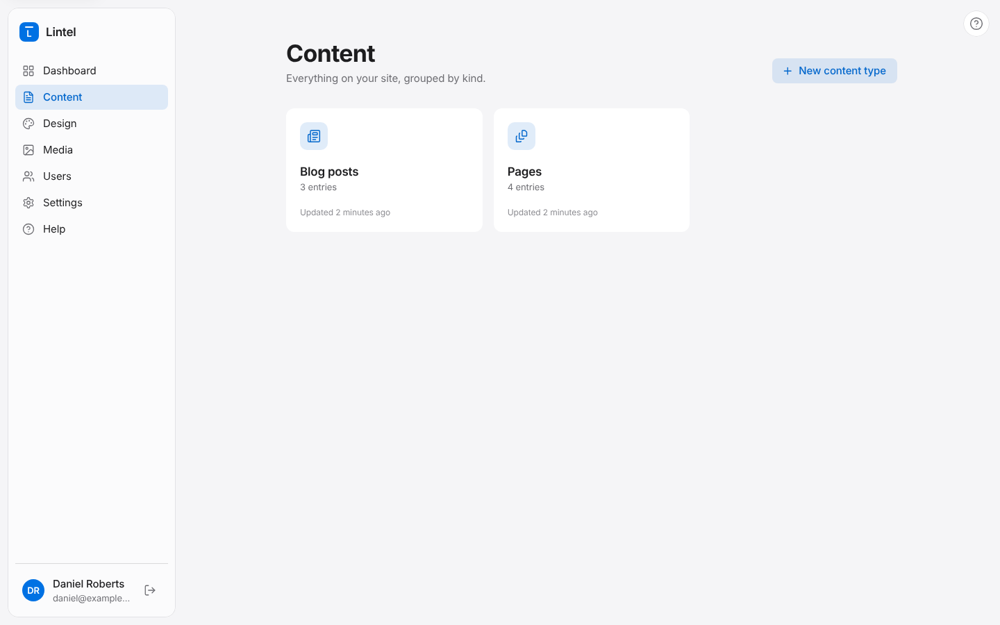
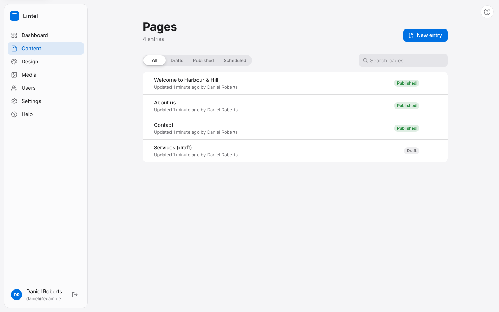
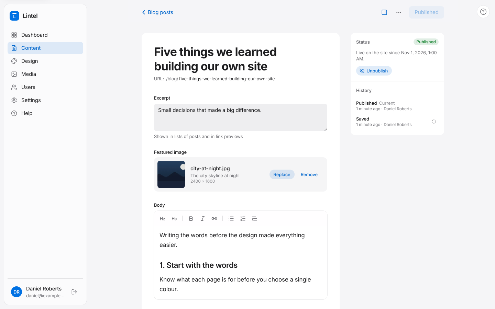

## Finding your content

**Content** in the sidebar shows a card for each kind of content your site has, such as
Pages and Blog posts, with how many there are.

Open one to see its entries. You can:

- **Search** by title.
- **Show** all entries, or only drafts, published or scheduled ones.
- **Change the order** of pages by dragging them, or with each row's up and down
  arrows. (Blog posts are always newest first.) Clear the search and filter first.

## Writing a new entry

1. Press **New entry**.
2. Type a **title**. As soon as there's a title, Lintel saves the entry as a draft.
3. Fill in the other fields. Fields marked **Required** must be filled in before you can
   publish.

### The web address

Under the title you'll see the entry's address, such as `/blog/my-first-post`. Lintel
makes it from the title. You can change it by clicking it. Once an entry has been
published its address stays the same even if you change the title, so links to it keep
working.

### The fields

What you fill in depends on the content type. The usual ones:

| Field         | How to fill it in                                                                |
| ------------- | -------------------------------------------------------------------------------- |
| **Text**      | A single line, such as a title.                                                  |
| **Text area** | A few lines of plain text, such as a summary.                                    |
| **Rich text** | Formatted writing. Use the toolbar for headings, bold, lists, links and quotes.  |
| **Image**     | Press **Choose image** and pick one from the media library, or upload a new one. |
| **Select**    | Pick from a list, such as a category.                                            |
| **Toggle**    | An on or off switch.                                                             |
| **Date**      | A date, sometimes with a time.                                                   |
| **Number**    | A number, such as a price.                                                       |
| **Link**      | A web address, email address or page, with optional link text.                   |

## Saving

Lintel saves as you type, about a second and a half after you stop. The top of the
editor says **Saving…**, then **Saved**. To save straight away, press
<kbd>Cmd</kbd>+<kbd>S</kbd> on a Mac or <kbd>Ctrl</kbd>+<kbd>S</kbd> on Windows.

If a save fails (for example, your connection drops), you'll see **Couldn't save** with a
**Try again** button. If you try to leave with unsaved changes, Lintel asks first.

Saving never changes your live site. Only [publishing](/using/publishing/) does.

## Pages inside pages

Pages can sit under other pages, like folders: "Our team" under "About us". Choose the
**Parent page** in the details panel on the right. Use **Show or hide details** at the
top to open or close that panel.

## Deleting an entry

Open **More actions** (the **…** button) and choose **Delete**. A deleted entry is removed
from your site straight away and can't be brought back.
